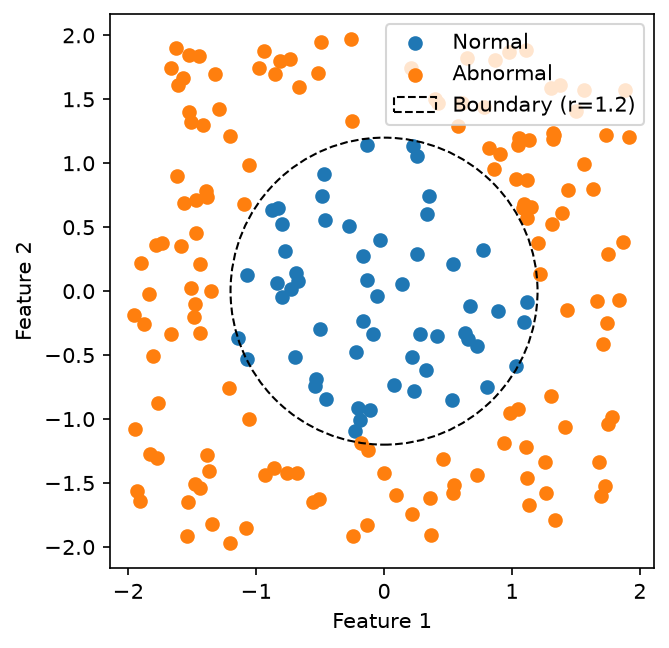

# NumPy Data Fundamentals

## 目標

使用 NumPy 建立 200 筆、每筆兩個 Features 的二維合成分類資料，
並使用 Matplotlib 視覺化。本輪不涉及模型訓練。

## 環境

- Python：3.14.7
- NumPy：2.5.4
- Matplotlib：3.11.2
- 隨機種子：42
- 核心依賴見 requirements.txt；完整本輪實測環境見 requirements-lock.txt

## 學習流程

Understand → Implement → Experiment → Verify

### Understand：理解資料與分類規則

每筆樣本有兩個 Features，代表平面上的座標 (x₁, x₂)。
兩個座標皆從 [-2, 2) 均勻取樣，共產生 200 筆樣本。

分類依據為座標到原點的距離平方：

- Normal（y = 0）：x₁² + x₂² ≤ 1.44
- Abnormal（y = 1）：x₁² + x₂² > 1.44

因為距離與半徑皆為非負數，平方後仍保有相同的大小關係，
所以可以直接比較距離平方與 1.44，不必先開根號。
理論邊界為以原點為圓心、半徑 1.2 的圓。
圓周上的點歸為 Normal。

標籤由事先設定的規則產生，並非模型預測結果。

### Implement：NumPy 語法紀錄

| 語法 | 本次用途 |
|---|---|
| np.random.default_rng(42) | 建立固定 Seed 的隨機數產生器 |
| rng.uniform(-2, 2, size=(200, 2)) | 產生 200 筆、每筆兩個座標 |
| X.shape | 查看各軸長度，本次為 (200, 2) |
| X.ndim | 查看軸數，本次為 2 |
| X.dtype | 查看元素型別，本次為 float64 |
| X[:5] | 取前 5 筆樣本 |
| X[:, 0] | 取所有樣本的第一個 Feature |
| X[:, 1] | 取所有樣本的第二個 Feature |
| y == 0 | 產生 Normal 樣本的 Boolean Mask |
| X[y == 0] | 取出 Normal 樣本，保留每筆的兩個 Features |
| .astype(np.int64) | 將布林值轉為整數標籤 0、1 |

y 是包含 200 個整數標籤的一維陣列。
y == 0 會逐一比較標籤，產生形狀為 (200,) 的布林陣列。

X[y == 0] 用這個布林陣列篩選 X 的列。
本次有 57 筆 Normal 樣本，每筆仍保留兩個 Features，
所以篩選結果的形狀是 (57, 2)，原始 X 的形狀則維持 (200, 2)。

### Experiment：實驗觀察

- 使用固定 Seed 42，兩次重新執行程式得到相同的取樣結果。
- 同一個隨機數產生器連續取樣時，會繼續往後產生數列，
  因此兩次取樣結果不同。
- 本次 200 筆樣本中，Normal 有 57 筆，Abnormal 有 143 筆。
- Scatter Plot 中，Normal 點位於半徑 1.2 的圓內，
  Abnormal 點位於圓外。
- 使用 ax.set_aspect("equal")，讓兩軸每單位的顯示長度相同，
  避免圓形邊界看起來像橢圓。

### Verify：驗證紀錄

執行結果：

- X.shape == (200, 2)
- y.shape == (200,)
- y 的標籤全部為 0 或 1
- Normal：57 筆，距離平方皆 ≤ 1.44
- Abnormal：143 筆，距離平方皆 > 1.44
- 重新建立 Seed 42 的產生器後，X 與 y 皆完全重現
- PNG 可正常開啟，包含兩類樣本、理論圓形邊界與圖例

程式使用 assert 檢查資料形狀與分類規則，
並使用 np.array_equal 檢查重新產生的資料與標籤是否完全相同。

終端機輸出：

    資料形狀與標籤驗證通過
    Seed 可重現性驗證通過

圖檔：

