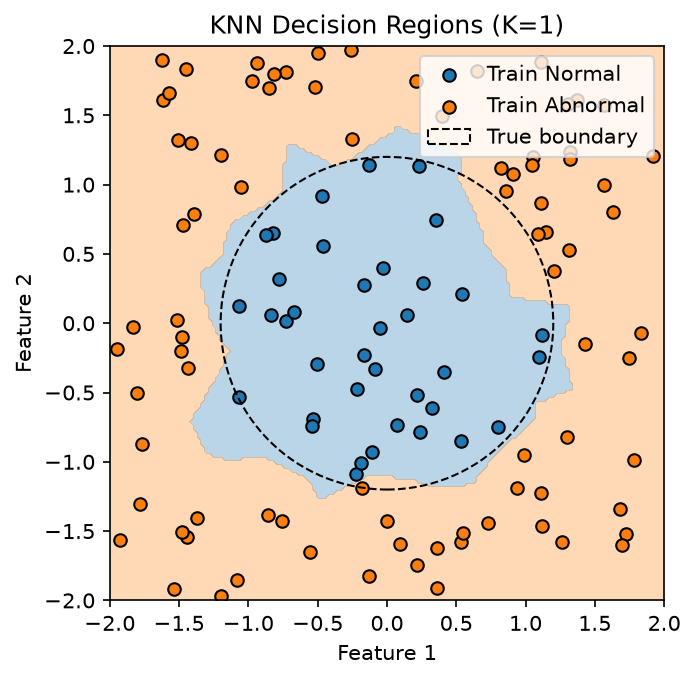
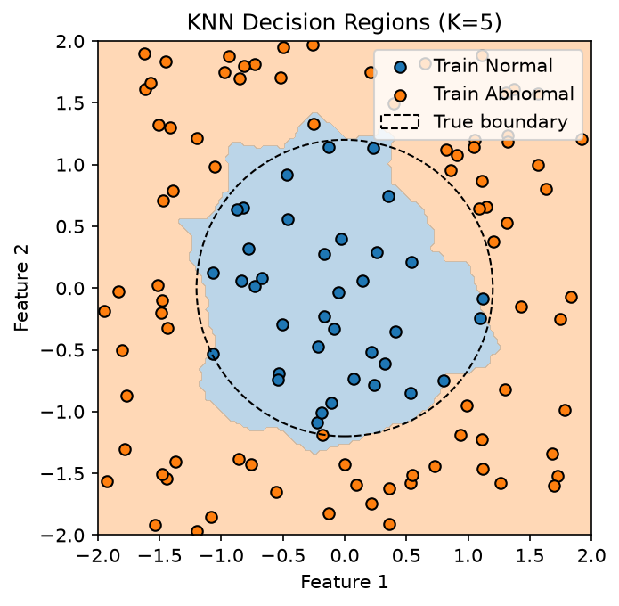
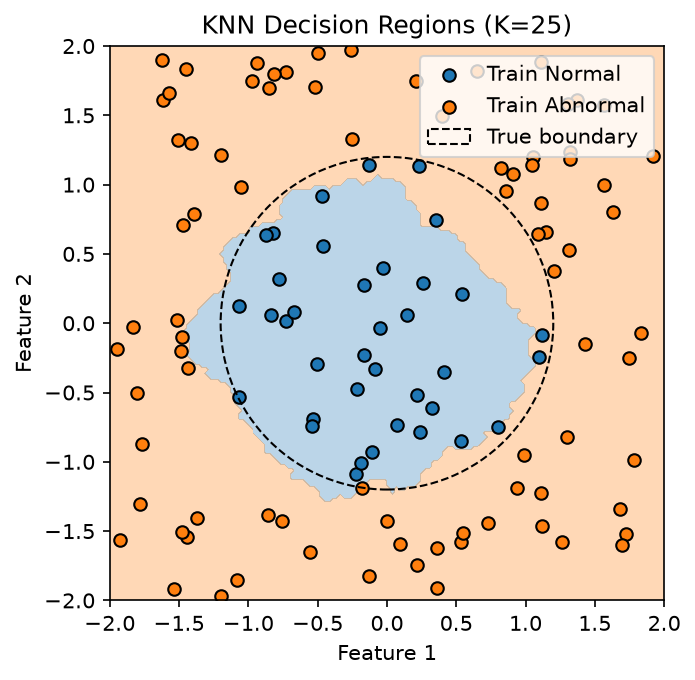

# KNN From Scratch

任務：A1-P01-L02｜使用 Python、NumPy、Matplotlib 從零實作二元分類 KNN。未使用 Scikit-learn。

## Understand：理解演算法

KNN 保留訓練資料，不在訓練階段擬合參數。對每個查詢點 q，計算它與所有訓練樣本的距離，找出最近 K 筆，再以等權重多數決預測類別。

二維 Euclidean Distance：

`d(x, q) = sqrt((x₁ − q₁)² + (x₂ − q₂)²)`

必須先加總各方向的平方差，再開根號；單獨對每個平方差開根號，只會得到各方向的絕對差。

### 資料與評估角色

沿用 L01 的 200 筆二維資料：`default_rng(42)`，兩個 Features 從 `[-2, 2)` 均勻取樣。

- Normal（0）：x₁² + x₂² ≤ 1.44，共 57 筆。
- Abnormal（1）：x₁² + x₂² > 1.44，共 143 筆。
- 真實邊界：圓心 (0, 0)、半徑 1.2；規則只生成標籤，不參與 KNN 預測。

另建 Seed 42 的產生器，透過 `permutation` 打亂索引，以相同索引成對取出 X、y。

| 資料 | 數量 | 用途 |
|---|---:|---|
| Train | 120 | 提供鄰居座標與標籤 |
| Validation | 40 | 比較 K 並選擇設定 |
| Test | 40 | K 確定後的最後評估 |

採一般隨機切分，未做類別分層。所有 K 共用相同切分。Validation、Test 都不加入鄰居來源；本輪選定 K 後也未合併 Train 與 Validation 重新訓練。

## Implement：NumPy 與數學的對應

| 實作 | 意義 |
|---|---|
| `X_train - query_point` | Broadcasting：每列樣本減去相同查詢點，(120, 2) − (2,) → (120, 2) |
| `differences ** 2` | 各座標差逐元素平方 |
| `np.sum(..., axis=1)` | 每筆樣本內的 Features 相加，得到 (120,) |
| `np.sqrt(...)` | 得到每筆樣本到查詢點的距離 |
| `np.argsort(..., kind="stable")[:k]` | 按距離由小到大取 K 筆索引，保留與標籤的對應 |
| `y_train[neighbor_indices]` | 取出鄰居標籤 |
| `np.bincount(..., minlength=2)` | 索引 0、1 分別存放 Normal、Abnormal 票數 |
| `np.argmax(votes)` | 取出票數最多的類別位置，而非最大票數本身 |
| `np.mean(y_true == y_pred)` | 逐筆比較標籤，再計算答對比例 |

`predict_one` 預測一筆；`predict` 逐筆呼叫它並在迴圈結束後回傳標籤陣列。Accuracy 比較的是類別標籤，不是預測機率。

距離相同時保留 Train 原順序；票數平手時選較小的類別編號。本次 K 均為奇數，二元投票不會平票。

### 決策邊界如何畫出來

每軸以 `linspace` 取 150 個等距位置，`meshgrid` 組合成 22,500 個規則排列的查詢點。兩張座標表經 `ravel` 攤平，再以 `column_stack` 合成 `(22500, 2)`。

KNN 預測所有點後，透過 `reshape` 排回 `(150, 150)`，由 `contourf` 依類別上色。背景顏色交界呈現模型的決策邊界；黑色圓形虛線僅作真實規則比較。網格不是新增訓練資料，圖形交界也受網格解析度影響。

## Experiment：結果與觀察

| K | Training Accuracy | Validation Accuracy |
|---|---:|---:|
| 1 | 100.00% | 97.50% |
| 5 | 97.50% | 95.00% |
| 25 | 95.83% | 95.00% |

依 Validation 最高分選定 **K=1**，之後才評估 Test：**95.00%（38/40）**。不根據 Test 結果重新選 K。

### Majority-Class Baseline

Train 的 Normal / Abnormal 數量為 37 / 83，因此 Baseline 對所有樣本固定猜 Abnormal（1）。多數類別只由 Train 決定。

Baseline Validation Accuracy 為 **72.50%（29/40）**。KNN 三種設定皆優於此基準，顯示使用座標鄰近關係比單純猜多數類別更有效。這是 Validation 上的比較，未另報 Baseline Test 分數。

### 泛化與局部誤判

- K=1 的訓練樣本能找到距離為零的自己，所以本次 Training Accuracy 為 100%；不代表完全掌握真實規則。
- K 增大後，投票參考更大範圍，可能降低個別樣本的影響，也可能把其他類別納入而造成誤判。
- 本次 K=25 的藍色區域在上方與右上方內縮，並非所有方向都等比例縮小。
- 查詢點 `(0.6, 0.8)` 的距離平方為 1，真實類別是 Normal。最近 25 位鄰居有 Normal 8 票、Abnormal 17 票，因而預測為 Abnormal；最近一位鄰居則是 Normal，K=1 在該點答對。
- K 較大不保證更準。本次 K=1 在 Validation 最佳，但單一小型合成資料與固定切分的結果，不能推論所有資料都適用 K=1。

### 決策邊界圖

## Verify：已完成的學習驗證

整理前逐步完成：3–4–5 三角形距離、人工資料 K=1/K=3 投票、多筆預測 `[0, 1]`、Accuracy 0.75、拒絕 K=0、索引完整性與三份切分不重疊檢查。
為讓最終程式聚焦演算法與實驗流程，移除上述示範與測試區；保留 K 合法性及 Accuracy 形狀檢查。核心流程未使用已完成的模型或資料切分工具。

## 實作限制與可解釋性

每個查詢點的距離計算為 O(n·d)，完整排序為 O(n log n)。此版本使用逐筆查詢與完整排序，便於對照數學步驟，尚未使用部分排序或搜尋加速。

本次兩個 Features 使用相同座標尺度，未另做縮放；若換成不同量綱的真實特徵，距離可能被較大尺度的欄位主導。此觀察不代表已實作前處理。
