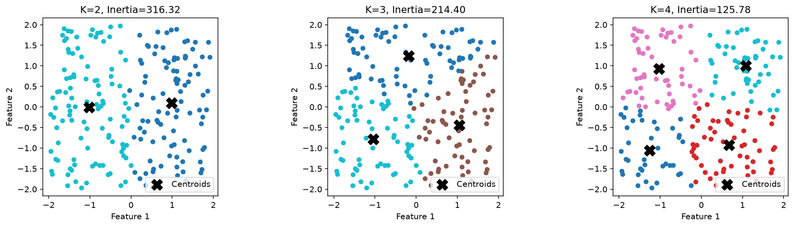
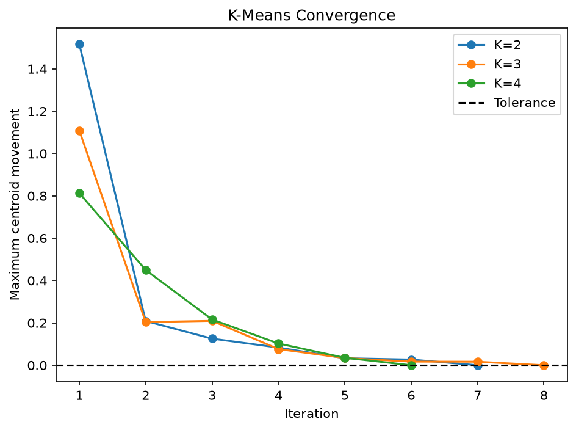

# K-Means From Scratch

A1-P01-L03｜個人學習紀錄

用 NumPy 實作 K-Means，從隨機選中心開始，反覆分配樣本與更新中心，再比較 K＝2、3、4。

## Understand 分群流程

KNN 需要已知標籤，讓鄰居投票預測類別；K-Means 不使用已知標籤，而是把座標相近的樣本分在一起。
群組 0、1 只是中心編號，不代表 Normal、Abnormal，也不自帶業務名稱。

流程是：
1. 從資料中隨機抽 K 筆不同樣本，作為初始中心。
2. 每筆資料比較到所有中心的距離平方，分給最近的中心。
3. 對每群的樣本取平均，得到新中心。
4. 計算新舊中心的移動距離，保存新中心。
5. 重複分配與更新，直到最大中心移動量不超過門檻，或達到最大更新次數。

資料沿用 L01：固定 data_seed＝42，在 [-2, 2) 均勻取樣 200 筆二維座標，X.shape＝(200, 2)。這次不建立 y，也沒有拿分類 Accuracy 當分群評分。

## Implement 變數與程式對照

| 名稱 | 裡面保存什麼 |
|---|---|
| X | 全部樣本座標，形狀 (200, 2) |
| centroids | 目前 K 個中心的座標，形狀 (K, 2) |
| cluster_ids | 每筆樣本所屬中心的編號，形狀 (200,) |
| new_centroids | 依本輪群內平均算出的新中心 |
| center_movements | 本輪每個中心移動的距離，形狀 (K,) |
| max_movement | 本輪最大的中心移動距離，一個數值 |
| movement_history | 每輪 max_movement 的紀錄 |
| inertia | 全部樣本到所屬中心的距離平方總和，一個數值 |
| cluster_counts | 每群有幾筆資料 |
| results | 依 K 保存各次實驗結果，避免下一次實驗覆蓋前一次結果 |

### 各函式的分工

| 函式 | 傳入 | 回傳 |
|---|---|---|
| initialize_centroids | X、K、Seed | 初始中心 |
| assign_cluster | X、目前中心 | 群組編號 |
| update_centroids | X、群組編號、舊中心 | 新中心 |
| fit_kmeans | X、K、初始化與停止設定 | 最終中心、群組編號、移動紀錄 |
| compute_inertia | X、群組編號、中心 | Inertia 數值 |

### 這次釐清的 NumPy 語法

- `rng.choice(..., replace=False)` 抽不重複的樣本編號；`X[selected_indices]` 才取出座標。
- `centroids - point` 透過 Broadcasting，讓所有中心都減去同一個樣本。
- `sum(axis=1)` 將每個中心的各方向平方差相加，得到各中心的距離平方。
- `argmin` 回傳最小值所在的位置，所以 cluster_ids 存的是中心編號，不是距離。比較遠近不必開根號。
- `X[cluster_ids == j]` 取出第 j 群成員；`mean(axis=0)` 對各欄跨樣本平均，得到該群的新中心。
- `centroids[cluster_ids]` 為每筆樣本配上自己的中心座標，不會重新找中心或更新中心。
- Inertia 最後使用 `sum(differences ** 2)`，不指定 axis，將所有樣本及所有 Features 一起加成一個總數。

### 曾卡住的地方

漏過 `centroids = new_centroids`，導致每輪都從同一組初始中心計算，跑滿 100 輪仍沒有累積更新。這行必須在迴圈內、停止判斷前，讓本輪新中心成為下一輪起點。
混淆過距離的加總與開根號順序。中心移動量要先對各方向的差平方、加總，再開根號；不能直接對可能為負的座標差總和開根號。
計算 Inertia 時，曾保留 axis=1，得到每筆樣本的距離平方陣列，而非全部加總的單一數值。修正的是輸出定義，不是把 assert 改成接受多個真假值。

## Experiment 我的實驗結果

設定：init_seed＝42、max_iterations＝100、tolerance＝0.0001。每個 K 只做一次隨機初始化，共用同一份 X。Seed 相同不保證不同 K 選到相同或互相包含的初始中心。

| K | Inertia 約值 | 更新輪數 |
|---|---:|---:|
| 2 | 316.32 | 7 |
| 3 | 214.40 | 8 |
| 4 | 125.78 | 6 |

三組皆達到中心移動量門檻。K＝2 的最終兩群為 95、105 筆；中心約為 (0.9839, 0.0993)、(-1.0210, -0.0117)，大致分成左右兩群。K＝3 分成三個區域，K＝4 大致分成四個角落。

### 中心移動量與 Inertia 是兩件事

中心移動量比較新舊中心，用來判斷是否停止；Inertia 比較樣本與所屬中心，用來描述群內集中程度。

例如只有一群，樣本為 (0, 0)、(4, 0)，舊中心為 (0, 0)：更新後中心是 (2, 0)，本輪移動量是 2，
Inertia 是 2²＋2²＝8。下一輪中心仍是 (2, 0)，移動量變成 0，
但 Inertia 仍是 8。中心穩定不代表所有樣本都重疊在中心。

我目前用最大中心移動量作停止條件，不是用 Inertia。tolerance 是收斂超參數，這裡採絕對距離門檻，會受資料尺度影響。
movement_history 用來保留過程，不是分群必須依賴的輸入；它的曲線也不要求每輪單調下降。

### 如何看待 K 的選擇

這次 K 從 2 增加至 4，Inertia 持續下降，但不能直接宣布 K＝4 最好。中心越多，本來就更容易縮短樣本到中心的距離；比較少數 K 的結果，也沒有清楚顯示唯一肘部。

這份資料均勻分布在正方形內，沒有預設的自然群團，所以這次重點是觀察 K 如何改變空間分割，而不是找回原本的圓形分類標籤。較快收斂也不代表分群一定更好。

理解後續可以透過更多候選 K、肘部法、輪廓係數與多次初始化穩定性協助判斷；這些延伸比較尚未實作。

如果應用在廣告受眾，業務需求可以限制候選 K，並用素材策略與場域成效驗證用途。但 K-Means 不保證自動得到男性、女性、汽車興趣或旅遊興趣等指定分類；同一個人也可能有多重興趣，而目前的硬分群每人只歸一群。群組需要檢查特徵後解讀，不能只靠數字命名。

## Verify 保留的驗證紀錄

學習過程已確認初始化形狀與固定 Seed 可重現、人工資料群組分配為 [0, 1, 0]、群平均中心為 [[2, 4], [9, 2]]、人工 Inertia 為 2，以及分群數量合計 200。

整理後保留必要輸入檢查，移除重複的單次 K＝2 實驗與逐筆群組列印。兩張圖分開使用 Figure 物件保存，避免誤把收斂圖存成分群圖。

### 分群結果

### 中心移動紀錄

## 本次範圍與限制

完成的是隨機初始化、最近中心分配、群平均更新、移動量停止判斷、Inertia 與 K＝2／3／4 比較。
空群保留原中心；等距時 argmin 選第一個中心。
不保證找到全域最佳解，也未加入 K-Means++ 或多次初始化選優。
