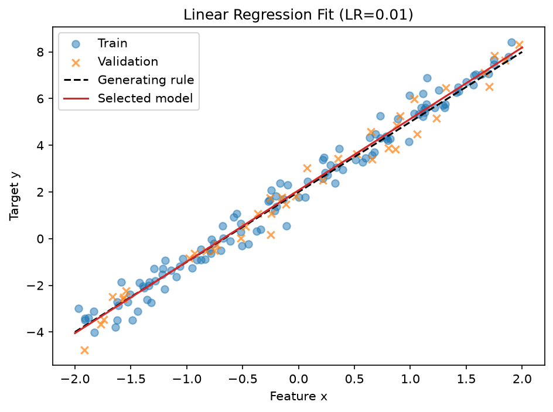
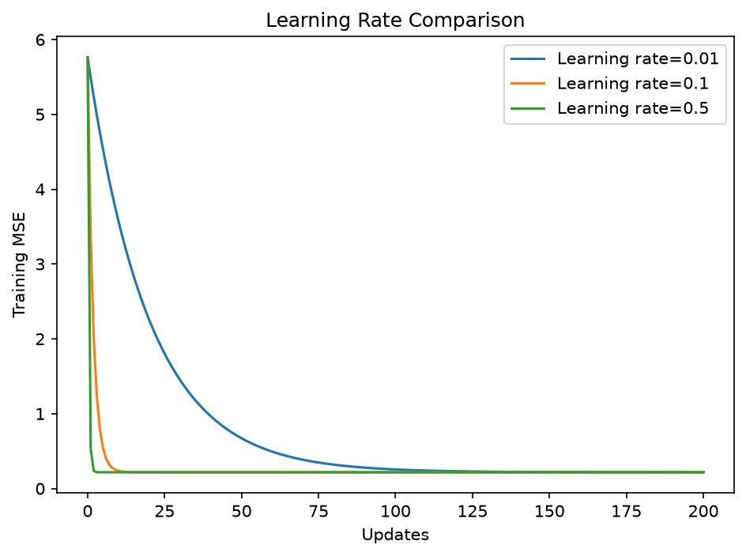
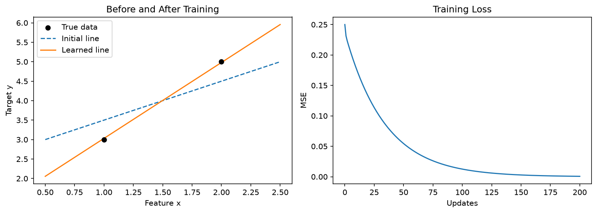

# Linear Regression From Scratch

A1-P01-L04｜Linear Regression 學習摘要

本次以 Python、NumPy、Matplotlib 實作單一 Feature 的線性回歸，完成預測、MSE、解析梯度、參數更新與學習率比較。
主線使用 200 筆帶雜訊資料；兩筆小資料與有限差分獨立保留，方便回頭理解梯度。


## 主線實驗

### 資料與設定

生成規則為 `y = 3*x + 2 + noise`，Weight＝3、Bias＝2 只用於生成資料與畫參考線，不直接指定為訓練結果。

| 設定 | 數值 |
|---|---|
| 樣本與 Feature 數 | 200 筆，每筆 1 個 Feature |
| Feature 取樣 | [-2, 2) 均勻分布 |
| noise | 常態分布，平均 0、標準差 0.5 |
| 資料 Seed / 切分 Seed | 42 / 42，使用獨立產生器 |
| Train / Validation / Test | 120 / 40 / 40 |
| 初始 Weight / Bias | 1.0 / 2.5 |
| 更新次數 | 200 |
| 候選 Learning Rate | 0.01、0.1、0.5 |

X 的形狀是 (200, 1)，取出第一欄後 x 為 (200,)，y 也是 (200,)。相同樣本索引成對用於 x、y，避免配對錯誤。
這份合成資料沒有時間先後，採隨機切分；股票等時間序列不能直接套用這種切分方式。

### 實作流程

`資料生成 → 固定切分 → Train 學習 → Validation 比較學習率 → 固定選擇 → Test 評估 → 存圖`

模型使用 `y_pred = weight*x + bias`。Loss 採 MSE，將每筆「預測減真實」的誤差平方，再對所有樣本取平均。

```python
errors = y_pred - y_true
grad_weight = 2 * np.mean(errors * x)
grad_bias = 2 * np.mean(errors)
```

每輪先根據同一組目前參數計算兩個梯度，才一起更新：

```python
weight = weight - learning_rate * grad_weight
bias = bias - learning_rate * grad_bias
```

梯度描述參數增加時 Loss 的局部變化方向，因此更新往反方向走。
負梯度會使參數增加，不代表固定的幾何旋轉方向；Bias 改變上下位置，Weight 改變直線斜率。
更新後重新預測並記錄 MSE。loss_history 包含第 0 輪的起始 Loss，加上 200 次更新後的值，共 201 個值。return 放在迴圈外，完成全部更新才回傳結果。

### 學習率比較

三組實驗共用相同切分、初始參數與更新次數，只改學習率。

| Learning Rate | Training MSE | Validation MSE |
|---|---:|---:|
| 0.01 | 0.217504 | 0.227815 |
| 0.1 | 0.217244 | 0.228299 |
| 0.5 | 0.217244 | 0.228299 |

0.01 下降較慢；0.1、0.5 較快到達穩定區域，這次 0.5 沒有發散。不代表學習率越大越好，穩定性仍與資料尺度和 Loss 曲面有關。
依固定 200 輪後的 Validation MSE 選出 **0.01**。它的訓練誤差略高、驗證誤差略低，差距很小，不能推論 0.01 對其他切分也最好。
`min(result, key=get_validation_mse)` 比較每個學習率對應的驗證分數，再回傳該學習率，不是直接選最小的學習率數字。


### 最終評估

| 項目 | 結果 |
|---|---:|
| 選定 Learning Rate | 0.01 |
| Weight | 3.0595270695 |
| Bias | 2.0708589459 |
| Training MSE | 0.217504（約值） |
| Validation MSE | 0.2278147834 |
| Test MSE | 0.3864786075 |

Test 使用選定實驗保存的 Weight、Bias，不使用比較迴圈最後留下的參數，也未合併 Train 與 Validation 重新訓練。
Test 未參與設定選擇，評估後不依其分數回頭調參。
Test 誤差較高，但 40 筆樣本的抽樣與雜訊也會影響結果，不能僅憑這個落差判定過擬合。
帶雜訊的資料不需要期待 MSE 為零；MSE 是平方單位的平均誤差，不是正確率。


### 主線圖表

擬合圖使用選定的 0.01 模型，顯示 Train、Validation、生成規則與學到的直線；沒有用 Test 圖形重新挑選模型。





## 輔助學習過程

### 從兩筆資料理解參數

固定資料 `x=[1, 2]`、`y=[3, 5]`，可由 Weight＝2、Bias＝1 完全吻合。這組答案只作對照，不直接交給訓練函式。

固定 Weight＝1，調整 Bias：

| Bias | 預測 | MSE |
|---|---|---:|
| 0 | [1, 2] | 6.5 |
| 1 | [2, 3] | 2.5 |
| 2 | [3, 4] | 0.5 |
| 2.5 | [3.5, 4.5] | 0.25 |
| 3 | [4, 5] | 0.5 |
| 4 | [5, 6] | 2.5 |

Bias 會讓所有預測增加相同數值，但不是越大越好。固定 Bias＝2.5 時，Weight 從 1 改為 1.1，兩筆預測分別增加 0.1、0.2，因為 Weight 的影響還要乘各自的 x。

### 先試一小步 再理解梯度

最初直接看解析梯度很難連結到程式，因此先用有限差分：

`變化率近似值 = (試調後 MSE − 目前 MSE) / 參數增加量`

估計 Weight 時固定 Bias；估計 Bias 時固定 Weight。兩次試探從同一組舊參數出發，不先修改其中一個參數。

在 Weight＝1、Bias＝2.5 時，Weight 的試探結果如下：

| 試探步距 | 平均變化率 |
|---:|---:|
| 0.1 | -0.25 |
| 0.01 | -0.475 |
| 0.001 | -0.4975 |
| 0.0001 | -0.49975 |

結果逐漸接近解析梯度 -0.5。Bias 的解析梯度為 0，單邊試探 0.0001 則得到約 0.0001，反映試探步距的近似誤差。

有限差分與解析梯度是在取得相同的局部變化資訊，但前者需實際試調，後者用推導後的公式直接計算。步距也不是越小越好，過小時會有接近數值相減造成的浮點誤差。

### 基礎數學複習入口

平方展開、Delta、平均變化率、導數極限及兩段 Chain Rule 的完整推導，統一見[完整數學推導與學習紀錄](../MATH_DERIVATION_NOTES.md)。本章保留有限差分與 MSE 的實驗連結，不重複抄寫基礎推導。

最新基礎教學驗收為 PASS；多參數偏導數與完整模型梯度仍需間隔複習。

### 小資料的訓練結果

輔助程式目前以解析梯度、學習率 0.1 訓練 200 次：

| 項目 | 結果 |
|---|---:|
| 初始 Weight / Bias | 1.0 / 2.5 |
| 初始 MSE | 0.25 |
| 最終 Weight | 1.9498976270 |
| 最終 Bias | 1.0810673425 |
| 最終 MSE | 0.0006625348 |
| 最終預測 | [3.03096497, 4.98086260] |

有限差分訓練也曾逐步完成：步距 0.01、學習率 0.1、200 輪後，MSE 約 0.001198。這是先前的學習紀錄；目前輔助檔保留有限差分函式作梯度對照，訓練改用解析梯度。



## 變數與函式的閱讀方式

| 函式 | 用途 | 回傳 |
|---|---|---|
| predict | 使用目前 Weight、Bias 預測 | 每筆預測值 |
| compute_mse | 比較預測與真實答案 | 一個 MSE 數值 |
| compute_gradients | 計算解析梯度 | Weight、Bias 兩個梯度 |
| fit_linear_regression | 重複預測、計算梯度與更新 | Weight、Bias、Loss 紀錄 |
| estimate_gradients | 輔助檔中的有限差分 | 兩個梯度近似值 |

`結果 = 函式(輸入)`：括號內傳入資料，return 交出結果，等號左邊接住。`weight, bias, loss_history` 是接收訓練結果，不是傳進函式的三個參數。

difference_step 控制估計斜率的試探距離，learning_rate 控制正式更新的幅度，iterations 控制重複次數。三者用途不同。

## 實作時修正的問題

- 建立 X 時誤用 data_seed 當樣本數，產生 (42,) 與 (200,) 無法逐元素相加的錯誤；Seed 控制起點，n_samples 控制筆數。
- return 放進訓練迴圈，會只做一輪就結束；函式外重複的訓練迴圈曾掩蓋這個問題，整理後只留單一主線。
- 比較學習率時，曾始終傳入固定的 `CONFIG["learning_rate"]`，導致三次結果相同；修正為傳入當輪的 learning_rate。
- 選定模型要從 result 取出參數，不使用最後一輪實驗的 weight、bias。

## 檔案與執行

從 MachineLearning 根目錄執行：

# 主線：200 筆資料、切分、學習率比較與 Test
python 04_linear_regression_from_scratch/linear_regression.py

# 輔助：兩筆資料、梯度對照與學習圖
python 04_linear_regression_from_scratch/linear_regression_learning.py
```


## 尚未涵蓋

目前只有單一 Feature、線性生成規則與一次固定切分，未實作多 Feature、正則化或股票預測。Learning Rate 與更新次數的結論限於本次設定
