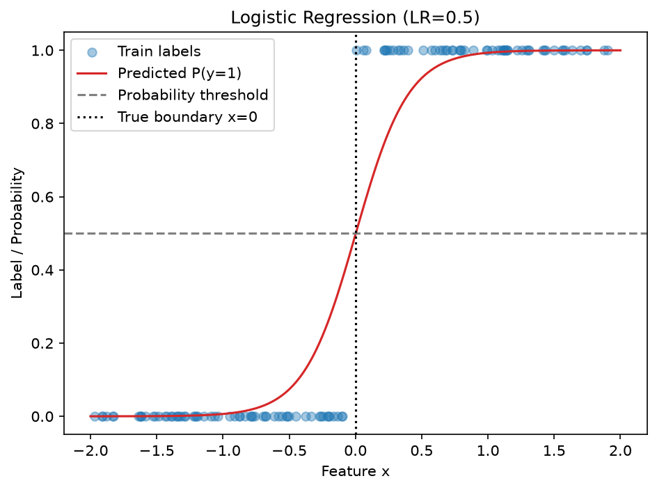
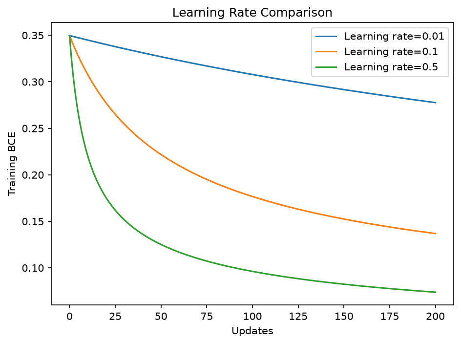

# Logistic Regression From Scratch

這次以 Python、NumPy、Matplotlib 完成單一 Feature 的二元分類，從線性分數、Sigmoid、BCE 接到解析梯度與參數更新。主線與輔助練習分開，方便複習數值與變數流向。未使用 Scikit-learn；實作整理完成。

## Understand 分數 機率與標籤

整體流程是：

**Feature → 線性分數 → 類別 1 的機率 → 門檻 → 預測標籤**

```python
z = weight * x + bias
p = sigmoid(z)
predictions = (p >= 0.5).astype(np.int64)
```

p 永遠是類別 1 的估計機率，類別 0 的機率是 1-p。
模型輸出 p=0.1，不是回答類別 1，而是在目前門檻下預測類別 0。

Sigmoid 是固定轉換，不會依一批資料的最大、最小值重新縮放。
分數 -2、0、2 分別轉成約 0.119、0.5、0.881；即使只有三筆，2 也不是能輸入的最大分數。

## Implement 核心函式與資料流

| 函式 | 傳入 | 回傳 |
|---|---|---|
| sigmoid | 線性分數 z | 類別 1 的機率 |
| predict_proba | x、Weight、Bias | 每筆機率 p |
| predict_labels | p、threshold | 0／1 標籤 |
| compute_bce | 真實標籤、機率 | 平均 BCE |
| compute_gradients | x、真實標籤、機率 | Weight 與 Bias 的梯度 |
| fit_logistic_regression | Train 與訓練設定 | Weight、Bias、Loss 紀錄 |

括號內傳入資料，return 交出結果，等號左邊按順序接住。每輪用相同的目前參數算兩個梯度，再更新；必須把 new_weight、new_bias 存回 weight、bias，下一輪才能累積學習。

```python
errors = p - y_true
grad_weight = np.mean(errors * x)
grad_bias = np.mean(errors)
```

這是 Sigmoid 搭配 BCE 的解析結果，不是所有模型都能直接把誤差當梯度。與 MSE 不同，這裡沒有乘 2。解析推導與 Chain Rule 仍是待複習項目，目前先以數值試探和程式資料流理解用途。

更新採 `參數 − learning_rate × 梯度`。loss_history 記錄第 0 輪及每次更新後的 BCE，200 次更新共有 201 個值；return 放在迴圈外。

## 主線實驗

### 資料與設定

| 項目 | 設定 |
|---|---|
| 資料 | 200 筆，單一 Feature，從 [-2, 2) 均勻取樣 |
| 真實標籤 | x>0 為 1，其他為 0 |
| 類別數量 | 0：104 筆；1：96 筆 |
| data_seed / split_seed | 42 / 42，獨立產生器 |
| Train / Validation / Test | 120 / 40 / 40 |
| 初始 Weight / Bias | 1.0 / 0.0 |
| threshold | 0.5，固定不調整 |
| iterations | 200 |
| learning_rates | 0.01、0.1、0.5 |

X.shape 為 (200, 1)，取出第一欄後 x.shape 為 (200,)，y 也是 (200,)。先打亂索引，再以同一組索引取出 x、y。真實規則只生成標籤，不直接用來預測。

### 初始模型與學習率比較

初始模型的 Training BCE 為 0.349688、Accuracy 為 100%。因初始參數剛好與真實分類方向一致，不需訓練就能答對，但機率仍有改善空間。

| Learning Rate | Train BCE | Validation BCE | Train Accuracy | Validation Accuracy |
|---|---:|---:|---:|---:|
| 0.01 | 0.277604 | 0.294535 | 99.17% | 100% |
| 0.1 | 0.136851 | 0.159380 | 99.17% | 100% |
| 0.5 | 0.073810 | 0.094132 | 100% | 100% |

所有設定使用同一份 Train、相同起點及 200 次更新。依 Validation BCE 最低選出 0.5，Accuracy 只是補充觀察。BCE 下降不保證答對筆數同步增加；LR=0.1 時，Training BCE 降低但曾有一筆跨過分類門檻而答錯。

`get_validation_bce(rate)` 的 rate 是呼叫時接收學習率的參數。`min(results, key=get_validation_bce)` 會逐一取得各設定的驗證分數，回傳最低分所屬的學習率，而非直接比較學習率大小。

### 最終 Test 評估

| 項目 | 結果 |
|---|---:|
| 選定 Learning Rate | 0.5 |
| Weight | 5.0304936297 |
| Bias | -0.0151277535 |
| Test BCE | 0.0929978859 |
| Test Accuracy | 100%（40/40） |

三組候選訓練與比較結束後，才取出選定模型做一次 Test 評估；不合併 Validation 重新訓練，也不依 Test 結果回頭調參。Test 全對的結論限於這份容易分開的合成資料。

0.5 門檻對應分數 z=0，所以本次決策分界約為 x=0.003，接近真實分界 0。

### 圖表與觀察

機率曲線顯示 Train 標籤、選定模型的機率、0.5 門檻及真實分界。散點是 0／1 標籤，紅線才是連續機率。



三組 Training BCE 都下降，0.5 在本次固定更新次數內最快、最低，未觀察到發散。不表示學習率越大越好。



資料完全可分，且未加正則化，模型可持續增大 Weight 使 BCE 接近零。因此這次只記錄「完成 200 次更新」，不宣稱參數已收斂；Accuracy 100% 也不代表機率已經校準。

## 輔助學習過程

### 從正確類別的機率理解 BCE

| 真實標籤 | 類別 1 機率 p | 類別 0 機率 1-p | 結果 |
|---|---:|---:|---|
| 0 | 0.1 | 0.9 | 答對，給正確類別較高機率 |
| 0 | 0.9 | 0.1 | 答錯，給正確類別較低機率 |

BCE 先看真實類別：y=1 使用 p；y=0 使用 1-p。給正確類別的機率越低，Loss 越大。兩筆 y=[1,0]、p=[0.9,0.1] 的 BCE 約 0.10536；反過來 p=[0.1,0.9] 則約 2.30259。

Accuracy 是 `mean(predictions == y)`：比較先得到 True／False，再按 1／0 取平均，得到答對比例；不是對機率取平均。

### 為什麼用 log 負號與平均

在標準的條件獨立建模假設下，各筆正確答案機率的乘積構成這批答案的 likelihood。
例如各筆都是 0.9，兩筆乘積為 0.81；各筆都是 0.6，乘積為 0.36。

log 把乘法改成加法，因為它讀取次方，而同底數相乘時次方相加。
負號把「越大越好」改成「Loss 越小越好」；最後平均，避免總分單純隨樣本數增加而變大。

### 保留容易閱讀的展開版

```python
safe_p = np.clip(p, 1e-12, 1 - 1e-12)
term_1 = y_true * np.log(safe_p)
term_0 = (1 - y_true) * np.log(1 - safe_p)
losses = -(term_1 + term_0)
return np.mean(losses)
```

y=1 時保留 term_1、關閉 term_0；y=0 時相反。乘 1 保留、乘 0 關閉，就是逐筆 if/else 的陣列版。
clip 只用來避免 log(0)，不是分類門檻。

zip 將同位置的真實標籤與機率配成一對。陣列版則一次處理整批，不再放進 for 重複 append，
避免把整批 Loss 陣列存成巢狀清單。

### 用有限差分對照梯度

對單筆 x=1、y=1，Weight=0、Bias=0，初始機率為 0.5。只提高 Bias，機率提高、BCE 降低。

用 `(試調後 BCE − 原 BCE) / step` 估計變化率，step=0.001 時，Weight 與 Bias 梯度近似值都約 -0.499875；解析結果為 -0.5。這筆 x=1，因此兩種參數增加同樣幅度，都讓分數增加相同幅度。

有限差分保留為本模型的數值對照。基礎導數、兩段 Chain Rule 與梯度更新已完成補充教學驗收，完整過程見[完整數學推導與學習紀錄](../MATH_DERIVATION_NOTES.md)；Sigmoid＋BCE 的獨立推導及矩陣梯度仍待補強。

## 檔案與執行

| 檔案 | 用途 |
|---|---|
| logistic_regression.py | 正式資料、切分、解析梯度訓練、選模、Test 與兩張圖 |
| logistic_regression_learning.py | Sigmoid、展開 BCE、zip 與有限差分對照 |

主線會更新本資料夾內兩張 PNG，不自動開啟圖形視窗。數值與圖檔整理後再執行確認；尚未加入多 Feature、標籤雜訊、正則化或門檻調整實驗，不推論到真實業務資料。
