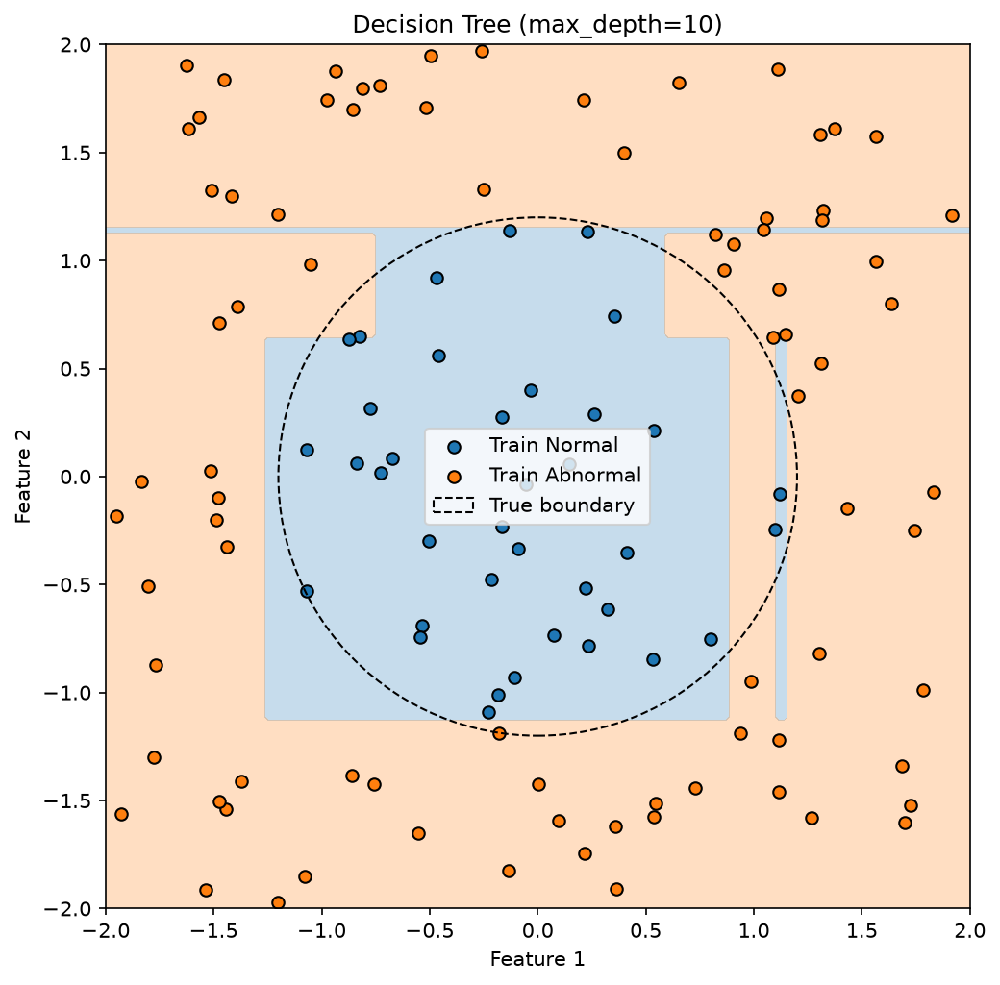
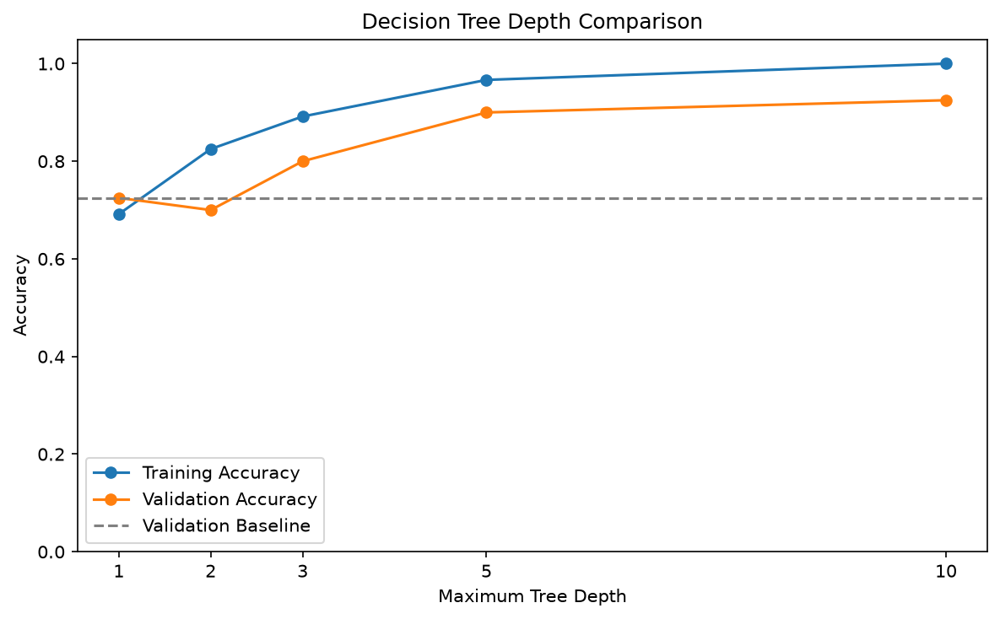

# Decision Tree From Scratch

主線：Gini → 候選中點 → 最佳欄位／切點 → 遞迴建樹 → 葉節點多數類別 → 新資料預測。

`decision_tree.py` 為正式實驗；`decision_tree_learning.py` 保留單層樹與小型數字檢查；`THEORY_QA.md` 保存理論問答。只支援非空、有限的數值 Features 與非負整數分類標籤，不是通用生產 API。

## 固定實驗

200 筆二維均勻取樣，圓內／外為 0／1。資料與切分 Seed 均為 42，Train／Validation／Test=120／40／40。

| 最大深度 | Training ACC | Validation ACC |
|---:|---:|---:|
| 1 | 0.6917 | 0.7250 |
| 2 | 0.8250 | 0.7000 |
| 3 | 0.8917 | 0.8000 |
| 5 | 0.9667 | 0.9000 |
| 10 | 1.0000 | 0.9250 |

依 Validation 選深度 10；Test ACC=0.9750。Train 多數類別為 1，Baseline Validation ACC=0.7250。真實圓形邊界僅產生標籤及繪圖，不直接用於模型預測。





## 函式與限制

- `compute_gini`：計算 1−各類別比例平方總和。
- `find_best_threshold`／`find_best_split`：比較左右子集按筆數加權的 Gini。
- `make_leaf`：多數類別作答；同票選較小類別。
- `prepare_node`：純群組、無可用切分或改善量不超過 1e−12 時停止。
- `build_tree`：另受 max_depth、min_samples_split 限制，左右只處理自己的子集。
- `predict_one`／`predict`：依規則走到葉節點，不需要真實標籤。

本章遇零改善切分就停止，可能無法發現 XOR 這種需先零改善再改善的模式；07／08 的建樹允許零改善，是刻意保留的教學差異。原生不處理 NaN、類別型欄位、剪枝或機率校準。

## 執行

從 Repository 根目錄：

```bash
python 06_decision_tree_from_scratch/decision_tree.py
python 06_decision_tree_from_scratch/decision_tree_learning.py
```

圖片保存到本資料夾，不會自動開啟視窗；發布前驗證範圍與實作限制見根目錄 README。
