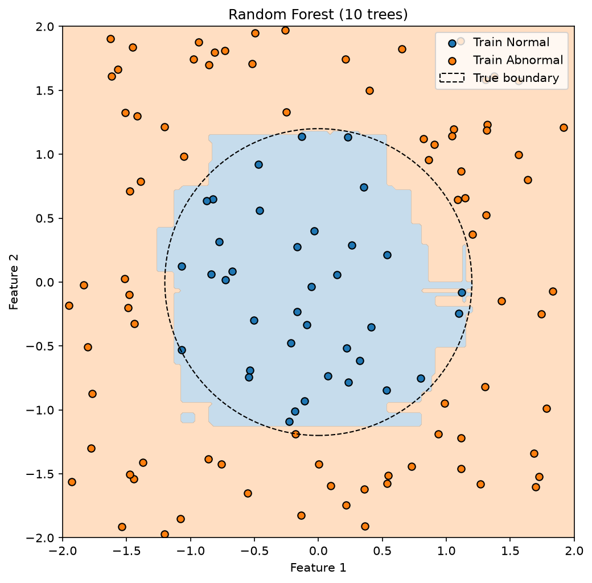
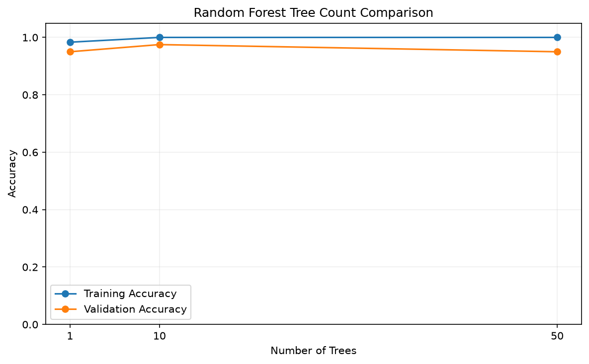

# Random Forest From Scratch｜學習摘要

課程：A1-P01-L05 的 Random Forest 實作部分。使用 Python、NumPy、Matplotlib，未使用 Scikit-learn 模型或切分工具

## 核心流程

```text
圓形資料 → 固定 Train／Validation／Test
                     ↓
每棵樹從 Train Bootstrap 抽樣
                     ↓
每個節點隨機選部分 Features，搜尋最低加權 Gini 的切分
                     ↓
遞迴建立多棵樹 → 每棵樹預測 → 逐筆多數決
                     ↓
比較樹數 → Validation 選模 → 最終 Test → 圖表
```

Bootstrap 是有放回抽樣，改變每棵樹看到的樣本組合；Random Feature Selection 在每個節點重新選欄，增加樹之間的差異。多數決整合多棵樹，但不保證每次都比單棵樹更準。

## 主程式與函式

主程式：`random_forest.py`。資料準備、實驗、選模與畫圖集中在 `main()`，方便沿主線閱讀。

| 函式 | 輸入 | 輸出／用途 |
|---|---|---|
| `bootstrap_sampling` | X、y、rng | 相同筆數、允許重複的 X_sample、y_sample |
| `select_feature_indices` | 總欄數、選取欄數、rng | 不重複的候選欄位編號 |
| `find_best_split` | 節點資料、max_features、rng | 候選欄位中最低加權 Gini 的規則，或 None |
| `build_random_tree` | 抽樣資料、深度與樣本數設定、rng | 保存規則和左右子節點的樹字典 |
| `fit_random_forest` | Train、樹數、樹設定、Seed | 保存多棵樹的清單 |
| `predict_random_forest` | 新資料、樹清單 | 每筆資料的最終類別，形狀 (樣本數,) |

沿用 `../06_decision_tree_from_scratch/decision_tree.py` 的 `find_best_threshold`、`make_leaf`、`predict`。執行時以檔案位置找到上一章，因此需要保留兩個資料夾的相對位置。

## 資料與 Config

- 200 筆二維座標，均勻取樣自 [-2, 2)；Normal 57 筆、Abnormal 143 筆。
- 分類規則：x₁²＋x₂² ≤ 1.44 為 0，否則為 1。
- Train／Validation／Test：120／40／40，沿用上一章切分。
- `data_seed`、`split_seed`、`forest_seed`：均為 42。
- `n_estimators_values=(1, 10, 50)`；`max_features=1`；`max_depth=10`；`min_samples_split=2`。

每次森林訓練建立一次產生器，在各樹抽樣與節點選欄間持續使用；不同樹數的實驗以相同 Seed 起始，因此較大的森林包含相同的前段樹。這次只比較樹數，未比較 max_features 或 max_depth。

## 實驗結果

| 樹數 | Training Accuracy | Validation Accuracy |
|---|---:|---:|
| 1 | 98.33% | 95.00% |
| 10 | 100.00% | 97.50% |
| 50 | 100.00% | 95.00% |

依 Validation Accuracy 選定 **10 棵樹**，沿用已訓練模型，最終 **Test Accuracy＝95.00%（38／40）**。Test 不參與設定選擇；同分時按 Config 候選順序選較早者。

上一章 Decision Tree 的 Validation／Test 為 92.5%／97.5%；本次森林為 97.5%／95%。Validation 較好、Test 少答對一筆，不能據此宣稱森林一定勝過單棵樹。兩版建樹的停止規則也不同，並非只改變樹數的嚴格對照。上一章 Majority-Class Baseline 的 Validation 為 72.5%，可作為相同切分下的參考，本程式未另行計算。

## 觀察與限制

- 1 到 10 棵時 Validation 上升，50 棵回到 95%；樹越多不代表本次準確率一定越高。
- 多棵樹投票後，上一章橫跨圖面的細長藍帶消失，但仍有局部小塊與延伸區域。
- 邊界仍由水平、垂直切分組成，無法直接還原平滑圓形。
- 只有單次切分與一組森林 Seed，不能證明模型的跨實驗穩定性；40 筆評估資料的一筆差異即為 2.5 個百分點。
- 使用 Hard Voting，每棵樹一票；同票時選較小類別編號，目前二元分類即為 0。未實作 Soft Voting、OOB 評估或特徵重要度。
- 抽到的候選欄位皆無切點時，直接成為葉節點，不再額外找其他欄位；這是本教學版的簡化。
- 允許零 Gini 改善的有效切分，仍受深度、樣本數與純度限制；與上一章零改善即停止的版本不同。
- 輸入假設為非空有限數值 Features、非負整數類別標籤及有效 Config。

## 圖表





網格為 150×150，共 22,500 個查詢點，只用於觀察模型，不參與訓練。折線連接已測試設定，不能代表中間樹數的實際成績。

## 執行與重現

在 MachineLearning 專案根目錄使用既有虛擬環境：

```bash
.venv/bin/python 07_random_forest_from_scratch/random_forest.py
```

執行後印出各設定的成績、選定樹數與 Test Accuracy，並保存兩張 PNG。相同資料、Config、程式與套件環境可重現結果。主線保留樹數與預測形狀檢查；整理時另確認固定 Seed 的森林與預測可重現，以及逐筆投票結果正確。

## 複習重點

- 能沿主程式說明 X、y 如何進入抽樣、建樹與投票。
- 分清楚樣本編號與欄位編號：Bootstrap 可重複；單節點選欄不可重複。
- `tree_predictions` 為 (樹數, 樣本數)；`.T` 後每列才是同一筆樣本收到的所有票。
- 熟悉遞迴子節點、字典與 rng 的傳遞，優先透過主線複習。
- Ensemble Variance 的完整推導暫不展開；Derivative、Chain Rule、Matrix Gradient 留待數學階段複習。
