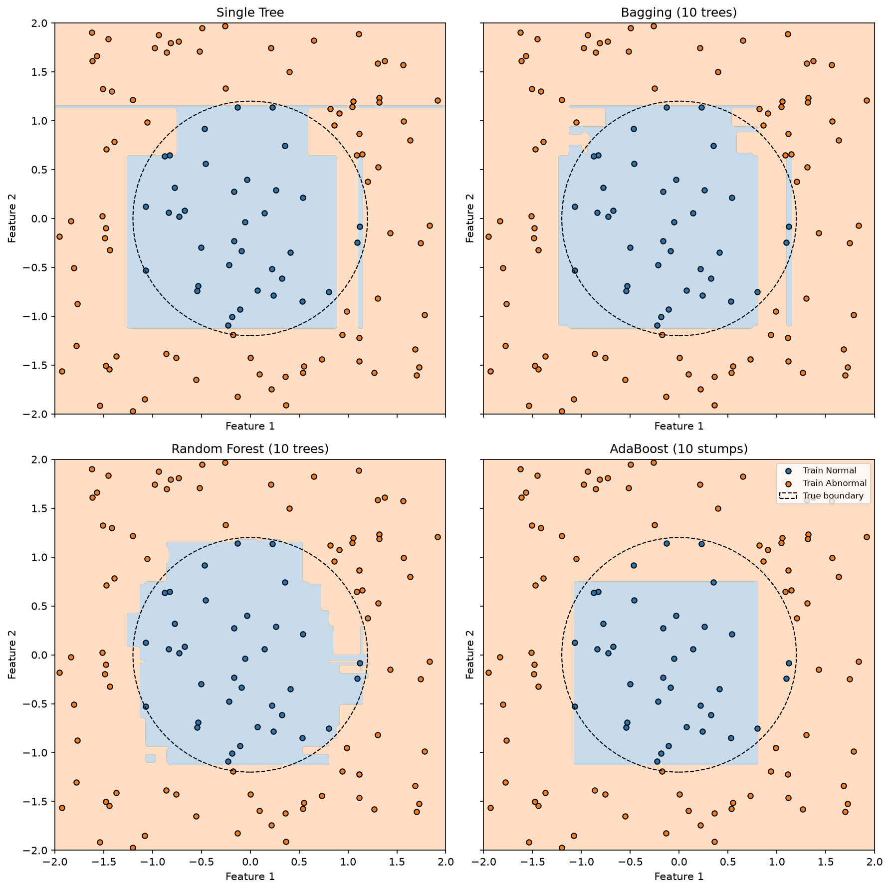
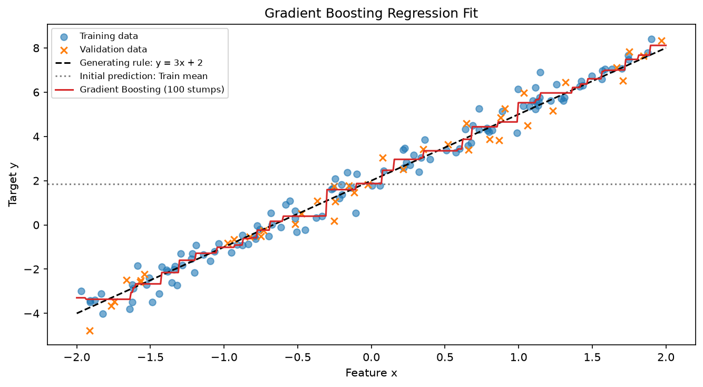
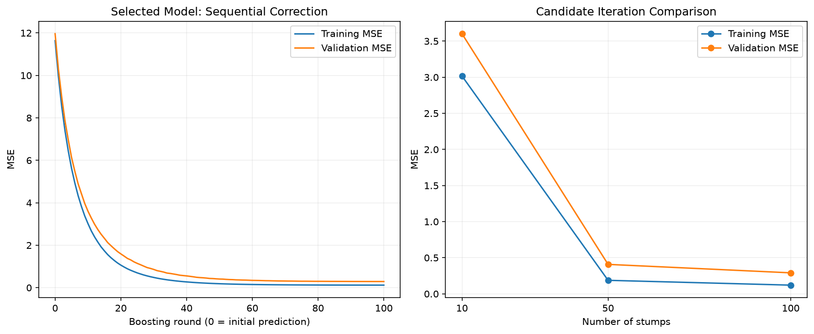

# L06｜Ensemble Learning 學習摘要

## 概念入口：大類 → 方法 → 工具

```text
Ensemble Learning：整合多個模型
├─ Bagging：各模型分別訓練，再整合
│  └─ Random Forest：Bootstrap＋節點隨機選欄的多棵樹
└─ Boosting：模型依序訓練，逐步改善整體預測
   ├─ AdaBoost：調整樣本重要性
   └─ Gradient Boosting：學習降低 Loss 的修正方向
      ├─ 手寫簡化回歸版本
      ├─ XGBoost 的梯度提升樹
      ├─ LightGBM
      └─ CatBoost
```

這是方便理解的層級圖，不是全部集成方法的完整清單，也不代表各分支在數學上完全互斥。AdaBoost 也能從特定損失函數的最佳化角度理解。

### Ensemble Learning｜整合多個模型

把多個模型的結果組合起來，希望得到比單一模型更可靠的預測。分類可以投票；回歸可以平均或加總。如何訓練、如何整合，由採用的方法決定，不保證每次都勝過單一模型。

### Bagging｜換樣本組合，分別訓練

```text
Train → 多組 Bootstrap → 各自訓練模型 → 分類投票／回歸平均
```

Bootstrap 是有放回抽樣：樣本可重複，也可能未被抽到。不同模型不需要根據前一個模型的錯誤訓練，主要希望降低對訓練樣本變動的敏感程度。

**Random Forest** 在 Bootstrap 訓練多棵樹之外，每個節點再隨機選部分候選 Features，增加樹之間的差異。`max_features` 控制的是各節點的候選欄數，不是整棵樹固定使用哪些欄。

### Boosting｜依序訓練，持續改善

後續模型依賴目前整體模型的不足，與 Bagging 各自訓練的方式不同。

**AdaBoost：改變樣本的重要性。**

```text
訓練模型 → 找錯誤 → 調整樣本權重 → 下一輪 → 加權投票
```

本次二元分類版本仍學習原本的 0／1 標籤，提高答錯樣本的權重，最後按各樹的 alpha 加權投票。樣本權重決定資料的重要性；alpha 決定樹的投票分量，兩者不同。AdaBoost 亦有其他變體，不能一概限定為二元分類。

**Gradient Boosting：學習降低目前 Loss 的修正方向。**

```text
目前預測 → 計算改善方向 → 新模型學修正 → 累加部分修正 → 下一輪
```

本次平方誤差回歸用 `真實值－目前預測` 作為殘差目標；最終輸出為起始預測加上各輪修正，不是殘差本身。Gradient Boosting 也能做分類或使用其他 Loss，那時不能直接套用原始標籤減預測值，需依 Loss 計算方向。

### Gradient Boosting 的具體實作與工具

| 實作／工具 | 本章掌握的功能與特色 |
|---|---|
| 手寫簡化版本 | 使用回歸單層樹學殘差，理解逐輪修正 |
| XGBoost | 結合梯度、曲率及正則化，計算切分收益與葉節點修正，並提供高效率訓練 |
| LightGBM | 分桶搜尋、優先擴展收益最大的葉節點，著重訓練效率 |
| CatBoost | 類別特徵處理、預設對稱樹與 Ordered Boosting 等設計 |

三種工具都能做分類與回歸，功能有重疊：分桶並非 LightGBM 獨有、正則化並非 XGBoost 獨有、類別支援也非 CatBoost 獨有。它們不是不同任務的專用工具，而是同一家族中採用不同設計的實作。

完整數字示例與官方來源見 [三種 Boosting 工具比較筆記](BOOSTING_TOOLS_COMPARISON.md)。

## 主線程式與實驗

### 分類策略比較

[ensemble_learning.py](ensemble_learning.py)：同一份圓形資料，Train／Validation／Test 為 120／40／40。

| 模型 | Training Accuracy | Validation Accuracy |
|---|---:|---:|
| Single Tree | 100% | 92.5% |
| Bagging：10 棵 | 100% | 90.0% |
| Random Forest：10 棵 | 100% | 97.5% |
| AdaBoost：10 棵單層樹 | 95.83% | 95.0% |

Single Tree、Bagging、Random Forest 深度上限為 10；AdaBoost 使用單層樹，因此不是僅替換集成策略的嚴格對照。Bagging 與森林共用主要停止條件，但隨機數消耗不同，Bootstrap 組合未逐棵固定。Test 尚未評估。



### Gradient Boosting 回歸

[gradient_boosting_regression.py](gradient_boosting_regression.py)：200 筆 `y＝3x＋2＋雜訊`，切分 120／40／40，Learning Rate＝0.1。

| 修正輪數 | Training MSE | Validation MSE |
|---|---:|---:|
| 10 | 3.0172 | 3.6027 |
| 50 | 0.1872 | 0.4080 |
| 100 | 0.1205 | 0.2909 |

依 Validation 選定 100 輪；Test MSE＝0.3948956。起始 Training MSE＝11.6364。Test 不參與輪數選擇。





### Boosting 工具的廣告案例

[xgboost_lightgbm_catboost.py](xgboost_lightgbm_catboost.py)：檔名保留三種工具名稱，目前只實際訓練 XGBoost，LightGBM／CatBoost 停在概念比較。

- 輸入為預算、折扣、是否紅牌；合成資料 300 筆，切分 180／60／60。
- XGBoost 100 輪、Learning Rate 0.1、max_depth 3、reg_lambda 1、hist 搜尋。
- Validation MSE＝38.6721，RMSE 約 6.22 件。
- 新活動為預算 7 萬、折扣 10%、紅牌，預測約 79.7972 件。
- 第 0／1／10／100 輪預測約為 88.7558／86.6227／79.4061／79.7972。
- Test 保留未評估；這是合成學習案例，不是廣告成效的因果模型。

## 執行與複習

在 MachineLearning 根目錄，選擇一條主線執行：

```bash
.venv/bin/python 08_ensemble_learning/ensemble_learning.py
.venv/bin/python 08_ensemble_learning/gradient_boosting_regression.py
.venv/bin/python 08_ensemble_learning/xgboost_lightgbm_catboost.py
```

分類實驗沿用 06／07 資料夾的樹與森林函式，需保留相對位置；廣告案例另需 XGBoost 套件。資料與切分 Seed 固定為 42；相同程式、Config 與套件環境可重現本次結果。

複習優先沿主程式追蹤輸入、學習目標、輸出與評估：

- Bagging：換樣本組合，再整合。
- AdaBoost：換樣本重要性，下一輪仍學分類答案，再加權投票。
- 本次 Gradient Boosting：換成學目前殘差，再累加修正。

一次成績或較平滑的邊界，不能證明跨訓練資料的穩定性。Variance 重複實驗尚未實作；完整 AdaBoost 最佳化、曲率與 Ordered Boosting 推導保留待複習。
