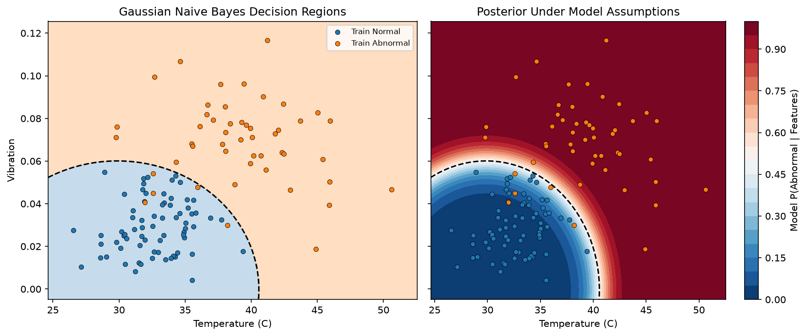

# L07｜Gaussian Naive Bayes From Scratch 學習摘要

## 主線與用途

以設備溫度、振動預測 Normal＝0／Abnormal＝1。訓練主要是計算各類的統計量，不使用 Gradient Descent。

```text
合成設備資料 → 固定 Train／Validation／Test
    → 只用 Train 計算 Prior、逐欄平均與變異數
    → Gaussian Log Likelihood → 加上 Log Prior
    → 各類分數 → Posterior／預測類別
    → Training／Validation → Baseline → 最終 Test → 圖表
```

正式實驗：[gaussian_naive_bayes.py](gaussian_naive_bayes.py)

公式展開、小資料及逐步輸出：[gaussian_naive_bayes_learning.py](gaussian_naive_bayes_learning.py)。保留單溫度 40°C、批次預測及多特徵的中間數字，供按需對照，不混入正式實驗輸出。

## 核心觀念與公式

- **Prior（先驗）**：還沒看新 Features，該類在 Train 中占多少。
- **Likelihood（似然）**：假設屬於該類，新數值在該類分布中的密度。
- **Posterior（後驗）**：結合新 Features 後，在模型假設下屬於各類的機率。
- **Gaussian 假設**：每類的每個 Feature 可用常態分布近似；不是把資料強制轉成常態。
- **Naive 假設**：給定類別後，Features 條件獨立。不是說全部資料中的 Features 無關。

### 訓練統計量

$$
P(y=k)=rac{n_k}{n},qquad
mu_{kj}=rac{1}{n_k}sum_{i:y_i=k}x_{ij},qquad
v_{kj}=rac{1}{n_k}sum_{i:y_i=k}(x_{ij}-mu_{kj})^2
$$

$n$ 是 Train 筆數，$n_k$ 是第 $k$ 類筆數，$j$ 是 Feature 編號，$mu$ 為平均值，$v=sigma^2$ 為變異數。`np.var` 使用預設 `ddof=0`。

### Gaussian 密度與類別分數

$$
f(x_jmid y=k)=rac{1}{sqrt{2pi v_{kj}}}
expleft(-rac{(x_j-mu_{kj})^2}{2v_{kj}}
ight)
$$

$f$ 是密度高度，不是該連續數值恰好發生的機率，也不是類別後驗機率；密度可以大於 1。

利用條件獨立近似，將同類各 Features 的密度相乘：

$$
s_k=P(y=k)prod_j f(x_jmid y=k)
$$

$$
P(y=kmid x)=rac{s_k}{sum_c s_c},qquad
hat y=operatorname*{argmax}_k s_k
$$

$prod$ 是相乘，$sum$ 是加總，$hat y$ 是預測類別。共同分母不改變排序，所以只做分類時不必先求 Posterior。

## 模型核心與數值穩定性

兩者分開理解：先知道模型算什麼，再處理電腦如何可靠地算。

**變異數下限：**`v_safe = maximum(v_raw, variance_floor)`，避免零變異數造成除以零。這會調整過小的模型統計量，可能改變預測；下限與 Feature 尺度有關，不是 Gaussian 公式的固定常數。

**Log 域：**原分數的等價改寫，避免多個小密度相乘下溢。不是先算出 0 再取 Log，而是直接計算：

$$
ell_{kj}=-rac12left[log(2pi v_{kj})+rac{(x_j-mu_{kj})^2}{v_{kj}}
ight]
$$

$$
a_k=log P(y=k)+sum_jell_{kj}
$$

理論上 Log 保留分數排序。求 Posterior 時先減去最大值：

$$
m=max_k a_k,qquad
P(y=kmid x)=rac{exp(a_k-m)}{sum_cexp(a_c-m)}
$$

共同平移保持比例，並讓至少一個指數值為 1，避免分母全部下溢為零。這改善本例數值穩定性，不代表任意無限大輸入都能有效計算。

## 主要函式與資料形狀

| 函式 | 輸入 | 輸出 |
|---|---|---|
| `fit_gaussian_naive_bayes_multifeature` | X：(n,d)、y：(n,)、變異數下限 | model：classes、priors、means、variances |
| `predict_one_gaussian_naive_bayes_multifeature` | point：(d,)、model | 單一類別、各類 Posterior：(K,) |
| `predict_gaussian_naive_bayes_multifeature` | X_new：(m,d)、model | predictions：(m,)、posteriors：(m,K) |

- `means`、`variances` 為 (K,d)，列代表類別、欄代表 Features。
- 訓練 `axis=0`：跨樣本、逐欄估計，不混合溫度與振動。
- 預測 `axis=1`：同一類別內，橫向加總各 Feature 的 Log 密度。
- Broadcasting 讓同一筆 point 與各類統計量計算。
- `argmax` 回傳位置，再以 `classes[位置]` 取得真實類別；同票時取排序較前的類別。
- 訓練、預測的 Feature 順序固定為 `[溫度, 振動]`。

## 小例子對照

六筆溫度 `[30,32,34,36,40,44]`，標籤 `[0,0,0,0,1,1]`：

| 類別 | Prior | 溫度平均 | 溫度變異數 |
|---|---:|---:|---:|
| Normal | 4／6 | 33 | 5 |
| Abnormal | 2／6 | 42 | 4 |

40°C 的 Likelihood 約為 `[0.001329, 0.120985]`；結合 Prior 後，Posterior 約 `[0.02149, 0.97851]`，預測為 1。

加入振動 `[0.02,0.03,0.02,0.03,0.08,0.10]` 後，各類平均振動為 0.025／0.09，變異數為 0.000025／0.0001。

新設備 `[40,0.09]` 的 Posterior 約為 `[8.80695e-39,1]`。極高機率依賴小樣本、窄分布與條件獨立假設，不能理解成真實世界絕對確定。

## 正式資料與實驗結果

使用 Python、NumPy、Matplotlib，不使用 Scikit-learn 模型或切分工具。

| 生成類別 | 筆數 | 溫度平均／標準差 | 振動平均／標準差 |
|---|---:|---|---|
| Normal | 120 | 33／3 | 0.03／0.015 |
| Abnormal | 80 | 39／4 | 0.07／0.02 |

`rng.normal` 的 `scale` 是標準差，不是變異數。標籤由生成類別決定，不是依溫度門檻計算；常態合成值也不是具有物理上下限的完整設備模擬。

- data_seed＝42、split_seed＝42。
- Train／Validation／Test＝120／40／40，Train 類別數 `[71,49]`。
- variance_floor＝1e-6，固定設定，沒有進行超參數搜尋。
- 只用 Train 計算所有模型統計量，Test 不參與訓練或調參。

| 評估項目 | 答對筆數 | Accuracy |
|---|---:|---:|
| Training | 115／120 | 95.83% |
| Validation | 39／40 | 97.50% |
| Test | 39／40 | 97.50% |
| Majority-Class Baseline Validation | 23／40 | 57.50% |

Baseline 只從 Train 找多數類別，固定預測 Normal＝0。模型的 Validation 高出 Baseline 40 個百分點。

## 圖表與觀察



左圖為預測類別，右圖為模型的 Abnormal Posterior，黑色虛線是 Posterior＝0.5 的分界；散點只顯示 Training。圖面範圍也由 Train 決定，不使用 Test。

- 分界是兩類分數相等的位置，不是固定溫度門檻。
- 各類的變異數不同，邊界可以彎曲，不一定是直線。
- 這份資料刻意符合類內常態、條件獨立的假設，成績良好不能直接推論至所有真實資料。
- 分布重疊可能造成錯誤；即使正確估計分布，也不一定能完全分開樣本。
- 同類 Features 若高度相關，可能重複計入證據，使 Posterior 過度自信。
- 樣本少、偏斜或多峰分布都可能影響估計；高 Accuracy 不代表後驗機率已經校準。

## 執行與驗證

在 MachineLearning 專案根目錄執行：

```bash
.venv/bin/python 09_gaussian_naive_bayes_from_scratch/gaussian_naive_bayes.py
```

主線印出資料數量、Accuracy、Baseline 並保存圖表。公式與中間值可另行執行：

```bash
.venv/bin/python 09_gaussian_naive_bayes_from_scratch/gaussian_naive_bayes_learning.py
```

整理後已確認：主線結果不變、學習例子可獨立執行、批次預測 `[0,1,1]`、後驗值有限且每列加總為 1；另檢查零變異數、遠離中心輸入與非 0／1 類別編號的對應。這些是正確性與數值檢查，不是額外泛化實驗。

目前函式假設非空有限數值、有效正變異數下限，以及配對正確的訓練標籤；未建立完整輸入驗證框架。原始學習版本已備份保留。

## 待補強與驗收

- 繼續熟悉 Prior、Likelihood、Posterior 與條件機率符號。
- 能沿主程式解釋 axis=0 的訓練統計與 axis=1 的證據加總。
- 尚未進行條件獨立違反、非高斯資料、重複切分或機率校準實驗。
- 與其他分類模型的正式同資料比較尚未進行。
- 數值穩定性與模型假設分開複習，不追加完整推導負擔。
