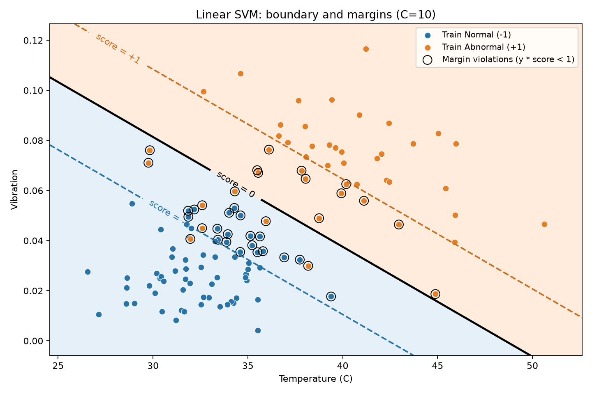

# L08｜Linear SVM From Scratch

以設備溫度與振動判斷 Normal／Abnormal，使用 NumPy 實作 Linear Soft-Margin SVM。主線實驗已完成，獨立數學推導仍列為待複習，不據此宣告完整 L08 驗收通過。

## 主線資料流

```text
建立設備資料 → 固定 Train／Validation／Test
    → 只用 Train 計算標準化參數
    → 各 C 從零訓練
    → Validation Accuracy 選模
    → 選定模型評估 Test
    → 畫分類邊界與 Margin
```

訓練內部：分類分數 → Hinge Loss 與權重代價 → 計算次梯度 → 更新 weights、bias → 重複。

## 檔案分工

| 檔案 | 用途 |
|---|---|
| `svm.py` | 主線實驗、核心演算法、分類邊界圖 |
| `svm_learning.py` | 原有手算候選對照、六筆訓練示範與檢查 |
| `SVM_DERIVATION_NOTES.md` | 保留完整圖解、符號翻譯、逐步數學推導 |
| `svm_boundary_margin.png` | 選定模型的分類邊界與分數 ±1 參考線 |
| `images/` | 先前的教學圖，保留供複習 |

修改前備份保留為 `.bak`，不參與執行。

## 實驗設定

- 合成資料：Normal 120 筆、Abnormal 80 筆，各有溫度、振動兩欄。
- Normal：平均 [33, 0.03]、標準差 [3, 0.015]。
- Abnormal：平均 [39, 0.07]、標準差 [4, 0.02]。
- 資料與切分 Seed 均為 42；切分 120／40／40，非分層切分。
- 標籤：Normal = −1，Abnormal = +1。
- 每個 C 都由 weights=0、bias=0 開始；learning_rate=0.05，更新 500 次。
- 標準化只由 Train 學習，其他資料沿用同一組平均值與標準差。

## 核心函式與輸入輸出

| 函式 | 輸入 → 輸出 |
|---|---|
| `decision_function` | X、weights、bias → 每筆分類分數 |
| `compute_svm_loss` | 資料、標籤、參數、C → 總目標、權重代價、平均 Hinge |
| `compute_svm_gradients` | 資料、標籤、目前參數、C → weights 與 bias 的次梯度 |
| `fit_linear_svm` | 標準化 Train、標籤、訓練設定 → weights、bias、loss_history |
| `plot_svm_boundary` | Train、選定模型、標準化參數 → 圖片路徑 |

X 形狀為 (樣本數, 2)，weights 為 (2,)，分類分數與預測標籤均為 (樣本數,)。

## 核心數學與實作用途

$$
s_i=w^Tx_i+b
$$

s 是分類分數，不是機率。分數 ≥0 預測 +1，否則預測 −1。

$$
J(w,b)=\frac12\sum_j w_j^2+C\frac1n\sum_{i=1}^{n}\max(0,1-y_i s_i)
$$

w 為特徵係數、b 為偏移、y 為真實標籤、n 為 Train 筆數；求和表示逐項加總。第一項控制權重大小，第二項懲罰分錯或間隔不足。C 控制第二項的相對比重；本實作採平均 Hinge，不能直接將 C 數值與使用加總 Hinge 的版本相比。

完整符號、數字代入與推導保留於 [推導筆記](SVM_DERIVATION_NOTES.md)，不要求目前能獨立重建。

## 實驗結果

| C | Training Accuracy | Validation Accuracy |
|---:|---:|---:|
| 0.1 | 0.5917 | 0.5750 |
| 1 | 0.9250 | 0.8500 |
| 10 | 0.9333 | **0.9000** |

依 Validation Accuracy 選出 C=10；同分時約定選較小的 C。直接沿用已訓練模型，Test 答對 37／40，Accuracy=0.925。Test 不參與選 C，也不據此回頭調整設定。

這是目前更新設定下的結果，不是 C 越大必然越好的證明。不同 C 的總目標定義已有改變，不直接用總目標數值跨組選模。

## 分類邊界與觀察



- 圓點顏色是真實標籤，背景顏色是預測類別。
- 黑線：score=0；兩側虛線：score=−1、+1。
- 黑圈：y×score<1，包含分錯及分對但間隔不足的點，不等同全部都是錯誤。
- 黑圈也不是經精確求解判定的完整 Support Vector 清單。
- 圖以原始單位呈現；訓練幾何與 Margin 在標準化座標中定義。
- 邊界傾斜表示溫度與振動共同影響分類。Soft Margin 允許部分間隔違反。

## 執行與驗證

從 MachineLearning 根目錄執行：

```bash
.venv/bin/python 10_svm_form_scratch/svm.py
.venv/bin/python 10_svm_form_scratch/svm_learning.py
```

主程式保存圖檔後關閉圖形，不會自動彈出視窗。需要 NumPy 與 Matplotlib。資料夾沿用既有拼字 `10_svm_form_scratch`。

已檢查切分編號不重複且無遺漏、Train 標準化平均約 0／標準差約 1、預測形狀與答案一致、Loss 與分數為有限值。原有手算對照與六筆示範保留；先前另以遠離 Hinge 轉折點的有限差分核對梯度。

## 學習狀態與限制

| 項目 | 目前狀態 |
|---|---|
| 分數、分類邊界、Margin 的關聯 | 已建立圖像直覺，尚未獨立驗收 Recall／Transfer |
| C 與間隔違反代價 | 能對照說明及實驗理解 |
| 訓練迴圈、Validation 選模、Test 流程 | 已完成主線並理解資料流 |
| 獨立推導邊界、Hinge 次梯度及更新公式 | 待複習 |
| 固定步幅的收斂與最佳化精度 | 尚未驗證；轉折附近可能震盪 |
| Kernel／RBF SVM | 尚未進入 |
| PCA | 尚未開始 |

本輪先以 Linear SVM 主線實作與結果理解收尾。固定切分的小型合成資料不能代表實際設備的泛化能力；尚未進行多組切分或重複訓練評估。後續複習從既有圖與數字接回，不必重做整章。
