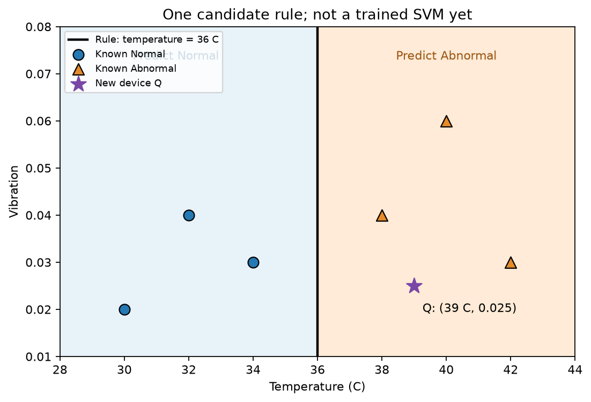
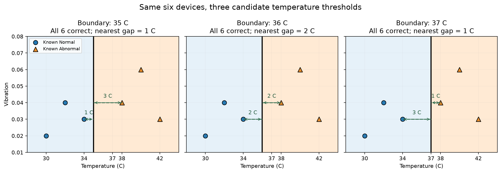
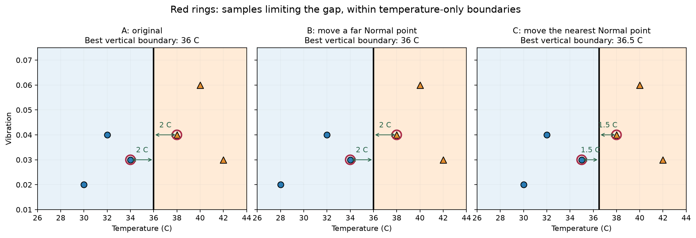
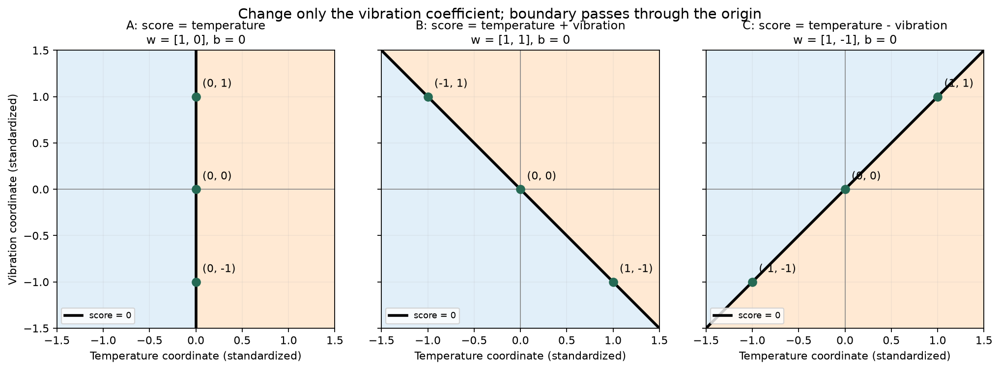
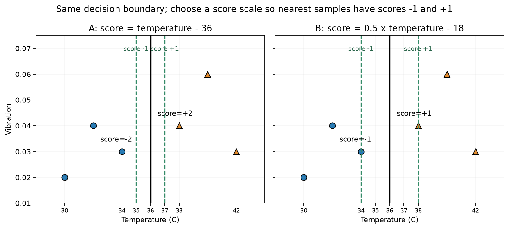
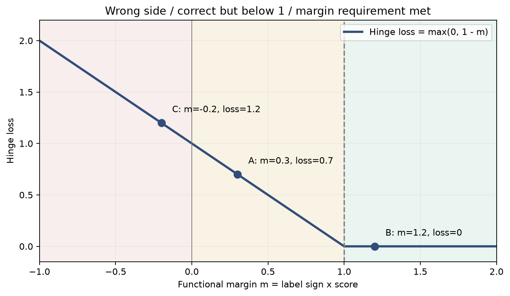

# Linear SVM｜視覺化推導與輔助學習筆記


## 1. 問題：同樣能分對，為什麼還要比較線？

已知設備的溫度、振動與 Normal／Abnormal 標籤，希望新設備也能被正確分類。先只看溫度：

| Normal 溫度 °C | 振動 | Abnormal 溫度 °C | 振動 |
|---:|---:|---:|---:|
| 30 | 0.02 | 38 | 0.04 |
| 32 | 0.04 | 40 | 0.06 |
| 34 | 0.03 | 42 | 0.03 |



暫時指定 36°C 為分界，左側猜 Normal、右側猜 Abnormal。新設備 Q＝[39°C, 0.025] 在右側，因此此規則預測 Abnormal。這條垂直候選線忽略振動；不是 SVM 永遠只能使用一欄。

這是在看懂一條規則，並非模型已完成訓練。剛好在線上的點需另訂同分處理，本程式採分數 ≥0 時選正類。

## 2. Margin：比較最近樣本到線的距離



最靠近兩類交界的是 Normal 34°C、Abnormal 38°C：

| 分界 | 左側最近溫度差 | 右側最近溫度差 | 兩者較小值 |
|---|---:|---:|---:|
| 35°C | 35−34＝1 | 38−35＝3 | 1°C |
| 36°C | 36−34＝2 | 38−36＝2 | **2°C** |
| 37°C | 37−34＝3 | 38−37＝1 | 1°C |

不是把左右距離加總，因為三者總和都是 4°C；比較的是**最近樣本的距離**，並希望這個最小值盡量大。

在只用溫度、要求完全分對的垂直線中，36°C 是最大間隔位置。這還沒有搜尋斜線；溫度與振動單位不同，之後一起做幾何比較前需先處理尺度。

本節「單側間隔」為邊界到最近樣本的距離，36°C 的單側間隔為 2°C；兩側空隙總寬度為 4°C。後面的「分數 ±1 帶」要另外區分，不能任意混用。

## 3. 哪些樣本限制間隔？Support Vectors 的直覺



- 把遠處 Normal 30°C 改成 28°C，兩類交界仍是 34／38°C，最佳垂直線仍在 36°C。
- 把最近 Normal 34°C 改成 35°C，最佳垂直線改為 (35＋38)／2＝36.5°C，單側間隔縮為 1.5°C。

Support Vector（支援向量）先理解為對邊界與間隔有關鍵約束作用的訓練樣本。本例中是交界兩側的樣本；Soft-Margin SVM 中，進入間隔或分錯的樣本也可能是支援向量，不能永遠理解成「只有最近兩筆」。

## 4. 把線寫成分數：先有規則，再替數字命名

要讓低於 36°C 得負分、等於 36°C 得 0、高於 36°C 得正分，最直接是：

```text
s＝溫度−36
 ＝1 × 溫度＋(−36)
```

因此這個示範設定為 w＝1、b＝−36。不是憑空假定最好的參數，而是在表示已指定的線。

$$
s=wx+b
$$

| 符號 | 意義 | 本例 |
|---|---|---|
| x | 輸入 Feature | 溫度，例如 34°C |
| w | Feature 前的係數 | 1 |
| b | 加到分數的偏移量 | −36 |
| s | 分類分數，不是機率 | 34−36＝−2 |

目前可選擇將 s 解讀為溫度差尺度；若改變係數，分數尺度也隨之改變。b 與 wx 使用相容的分數尺度，不應一概把任意 b 當成邊界的攝氏溫度。

黑線上 s＝0：

```text
wx＋b＝0
wx＝−b
x＝−b／w    （此處要求 w≠0）
```

所以 b 不是直接等於線的位置。固定 w＝1 時，要改成 37°C 分界，就設 b＝−37。

### 兩個 Features：方向為什麼能傾斜？



$$
s=w_1x_1+w_2x_2+b
$$

這張圖使用**標準化座標**，不是前面原始攝氏溫度。x₁ 為溫度座標、x₂ 為振動座標，w₁、w₂ 是各欄係數。

- w=[1,0]、b=0：s=x₁，黑線為 x₁=0，振動不影響判斷。
- w=[1,1]、b=0：s=x₁+x₂。黑線上的點須互相抵銷，例如 (-1,1)、(0,0)、(1,-1)。振動增加，溫度須減少，線因此傾斜。
- w=[1,-1]、b=0：s=x₁−x₂，黑線上的兩個座標相等，例如 (-1,-1)、(0,0)、(1,1)。

調整 weights 改變邊界方向；weights 固定時，bias 改變線的位置。這些都是候選規則，訓練才會尋找適當參數。

## 5. 同一條線可以有不同分數

將整個式子乘以正數 2：

```text
A：s＝x−36         → w＝1、b＝−36
B：s＝2(x−36)      → w＝2、b＝−72
```

| 溫度 | A 分數 | B 分數 |
|---|---:|---:|
| 34°C | −2 | −4 |
| 36°C | 0 | 0 |
| 38°C | ＋2 | ＋4 |

兩者都在 36°C 得 0，兩側正負不變，分類線完全相同。**w、b 必須一起放大，不能只改 w 還說線不動。**

38°C 到線的溫度差仍是 2°C，分數卻可以是 2 或 4，因此分數不一定等於距離。本例可還原：

$$
\text{距離}=\frac{|s|}{|w|}
$$

絕對值 |⋅| 表示不保留方向正負。A 為 2／1＝2°C，B 為 4／2＝2°C。

## 6. 為什麼使用分數 −1、＋1？



仍固定 36°C 黑線，將原式除以 2：

```text
s＝(x−36)／2＝0.5x−18
```

| 溫度 | x−36 | 0.5x−18 |
|---|---:|---:|
| 34°C | −2 | −1 |
| 36°C | 0 | 0 |
| 38°C | ＋2 | ＋1 |

分數尺度不同，線沒動。對這個可完全分開的例子，選擇尺度讓最近樣本剛好達到 ±1，就能用共同要求表示：Normal 分數 ≤−1，Abnormal 分數 ≥＋1。

固定的是分數參考基準，**不是固定邊界只改權重**；真正訓練仍會調整方向、位置與尺度。

圖上的綠色虛線是分數 ±1，不一定等於最近樣本所在位置：

- w=1 時，在 35／37°C，總帶寬 2°C，兩筆樣本在帶外。
- w=0.5 時，在 34／38°C，總帶寬 4°C，兩筆樣本剛好碰到帶。
- w=0.25、b=−9 時，在 32／40°C，總帶寬 8°C；34／38°C 樣本落入帶內，違反 ±1 要求，儘管仍分對。

對正的單一溫度係數：

```text
分數＋1 的位置：x₊＝(1−b)／w
分數−1 的位置：x₋＝(−1−b)／w
兩者相減：帶寬＝2／w
```

因此希望權重較小、帶寬較大，但又必須考慮樣本是否違反間隔要求。

## 7. 真實標籤乘分數：統一兩種類別的判斷

本章 SVM 訓練標籤編成 Normal=−1、Abnormal=＋1。標籤的 ±1 是類別編碼；分數的 ±1 是參考位置，兩者角色不同。

$$
m_i=y_i s_i
$$

m 稱為 functional margin（函數間隔），不是幾何距離。下標 i 表示第 i 筆樣本。

| 真實類別 | 分數 s | 相乘 m | 意義 |
|---|---:|---:|---|
| Normal：−1 | −1 | ＋1 | 分對且達標 |
| Abnormal：＋1 | ＋1 | ＋1 | 分對且達標 |
| Normal：−1 | ＋0.5 | −0.5 | 分錯 |
| Normal：−1 | −0.5 | ＋0.5 | 分對但間隔不足 |

相乘讓兩類共用一把尺：m<0 分錯；m=0 在線上；0<m<1 分對但未達要求；m≥1 達標。等於 0 的最終類別依同分規則處理。

## 8. Hinge Loss：衡量未達要求多少



圖橫軸為 m=y×s，縱軸為單筆 Hinge Loss；A、B、C 為先前標準化座標示例，曲線規則通用。

$$
\ell_i=\max(0,1-y_i s_i)=\max(0,1-m_i)
$$

ℓ（ell）是單筆損失；max 表示兩數取較大者。

| m | 計算 | Hinge Loss |
|---:|---|---:|
| −0.5 | max(0,1−(−0.5)) | 1.5 |
| 0.5 | max(0,1−0.5) | 0.5 |
| 1.5 | max(0,1−1.5) | 0 |

未達 1，按不足量懲罰；達標後這項損失為 0。1 是函數間隔基準，不是 1°C 或 1 公尺。

```python
signed_scores = y_signed * scores
hinge_losses = np.maximum(0.0, 1.0 - signed_scores)
```

`np.maximum` 逐筆與 0 比較，並非從整個陣列只找一個最大值。

## 9. 為什麼不能只降低 Hinge Loss？

同一條 36°C 線可任意放大分數，兩筆資料也沒移動。較大的分數不代表邊界的實際最近距離增加。

以 34／38°C 為例：

| w、b | 兩筆分數 | 平均 Hinge Loss | ±1 總帶寬 |
|---|---|---:|---:|
| 1、−36 | −2／＋2 | 0 | 2°C |
| 0.5、−18 | −1／＋1 | 0 | 4°C |
| 0.25、−9 | −0.5／＋0.5 | 0.5 | 8°C |

前兩組 Hinge 都是 0，卻沒有偏好更寬帶的訊號。因此加入控制權重大小的代價；但也不能只縮小權重，否則可能讓樣本落進帶內甚至分錯。

## 10. 權重代價與 C：完整目標

$$
\text{weight penalty}=\frac12\sum_j w_j^2
$$

Σ_j 表示把每個 Feature 的係數平方加總。單一 Feature 就是 0.5×w²。平方衡量大小，不能讓正負相互抵銷；0.5 是慣用係數，後續微分時方便。

本次採平均 Hinge 的目標：

$$
J(w,b)=\frac12\sum_j w_j^2
+C\frac1n\sum_{i=1}^{n}\max\left(0,1-y_i(w^Tx_i+b)\right)
$$

| 符號 | 名稱／用途 |
|---|---|
| J | 要降低的總目標值 |
| w | 各 Feature 係數組成的向量 |
| b | 分數的偏移量，本目標不額外懲罰 b |
| x_i | 第 i 筆樣本的 Feature 向量 |
| wᵀx_i | 對應係數與 Feature 相乘後加總；ᵀ 表示轉置 |
| y_i | 第 i 筆真實類別，編為 −1／＋1 |
| n | 訓練樣本數，1/n 使損失取平均 |
| C | 正的超參數，控制間隔違反的相對代價 |

資料尺度會影響係數與代價，所以原始溫度手算只用於建立直覺；正式多特徵訓練將先處理尺度。這個目標不是不同單位任意混合的物理能量。

同一組 34／38°C 的候選比較：

| w、b | 權重代價 | 平均 Hinge | C=1 的總目標 | C=0.1 的總目標 |
|---|---:|---:|---:|---:|
| 0.5、−18 | 0.125 | 0 | 0.125 | 0.125 |
| 0.25、−9 | 0.03125 | 0.5 | 0.53125 | 0.08125 |

例如第二組、C=0.1：

```text
0.5×0.25²＋0.1×0.5
＝0.03125＋0.05
＝0.08125
```

- C 較大：更重視減少分錯與間隔不足。
- C 較小：相對更重視控制權重，容許較多間隔違反。

這只是在兩個候選中比較，不是聲稱某個 C 的全域最佳權重就是 0.5 或 0.25。C 也不是直接指定間隔的距離。

有些教材用 Hinge「加總」而非「平均」，因此相同 C 數值不保證相同強度。對 n 筆資料，若其他項相同，本版 C_mean 對應加總版 C_sum=C_mean/n。

## 11. 公式接回 NumPy

主程式：[svm.py](svm.py)。

```text
decision_function：X、weights、bias → 每筆 scores
compute_svm_loss：X、真實標籤、候選參數、C
    → scores → y*s → Hinge Loss
    → 權重平方總和
    → 回傳總目標、權重代價、平均 Hinge
```

| NumPy | 數學／用途 |
|---|---|
| `X @ weights + bias` | 各筆各欄相乘加總，再加 b |
| `y_signed * scores` | 逐筆真實標籤乘分數 |
| `np.maximum(0, 1-signed_scores)` | 逐筆 Hinge Loss |
| `0.5 * np.sum(weights ** 2)` | 權重代價 |
| `np.mean(hinge_losses)` | 平均資料損失 |

X 的 shape 為 (樣本數, Features)，weights 為 (Features,)，scores 為 (樣本數,)。

例如 X=[[34],[38]]、weights=[0.5]：

```text
X @ weights → [17,19]
加 bias -18 → [-1,+1]
乘 y [-1,+1] → [1,1]
Hinge → [0,0]
權重代價 → 0.125
C=1 時總目標 → 0.125
```

## 12. 執行、目前進度與待補強

從 MachineLearning 根目錄執行：

```bash
.venv/bin/python 10_svm_form_scratch/svm.py
```

資料夾沿用目前名稱 `10_svm_form_scratch`，本輪未重新命名。正式主線已移至 svm.py；本筆記中的手算與六筆訓練示範由 svm_learning.py 獨立執行。正式 C 比較、選模及 Test 結果見 README.md。


## 13. 訓練接線：先走通，不重複展開推導

```text
標準化資料 → 分數 → 找 y*s<1 的樣本
    → 累積各筆梯度 → 加權重代價梯度
    → weights、bias 同時更新 → 計算新總目標 → 下一輪
```

未達標樣本對 Hinge 的貢獻為 `−y × point`（權重）與 `−y`（bias）；已達標貢獻為 0。全部樣本平均後乘 C，權重再加上自身的代價梯度 weights。等於 1 的轉折點沒有唯一普通導數，此版採用不活躍的 0 次梯度。

逐步理解例子：Normal 座標 −1、bias=0 時，分數=−w，尚未達標的 Loss=1−w，所以對 w 的變化率為 −1；Normal 座標 −2 時，Loss=1−2w，變化率為 −2。Abnormal 座標 +2 時，Loss=1−2w，變化率也為 −2。`−y × point` 將兩種類別的規則合寫，不是任意指定方向。

每筆貢獻先加總，再除以全部樣本數；分母不是只算未達標筆數。權重代價 0.5*w² 的導數為 w，bias 沒有這項懲罰。兩種梯度都由同一組目前參數計算，再一起更新，不在遍歷樣本時逐筆改參數。

正式參數更新不再使用前面的限制 `bias=-36*w`；weights、bias 分別更新，方向與位置都可能改變。

### 本次六筆訓練示範結果

- 兩欄標準化平均：[36, 0.03666667]；標準差約 [4.3204938, 0.01247219]。
- 標準化只做座標轉換，不計算 Gaussian 密度，也不假設常態。
- C=1、learning_rate=0.05、500 輪；weights、bias 從 0 開始。
- 起始總目標 1.0，最終約 0.5391642。
- weights 約 [0.65229078, 0.15513349]，bias 約 0.10833333。
- 六筆訓練預測全部正確；只是接線示範，不是泛化評估或最大間隔最佳解的證明。
- 另在遠離 Hinge 轉折點的例子，以有限差分確認 weights／bias 梯度一致。

Hinge 不光滑，固定步幅的次梯度訓練可能在轉折附近波動，不能要求每輪嚴格下降；正式主線已完成三組 C 的比較，但尚未完成收斂驗證。
