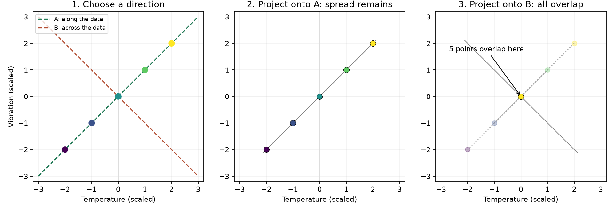
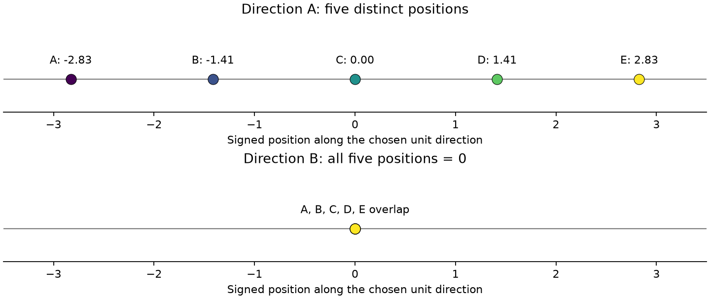
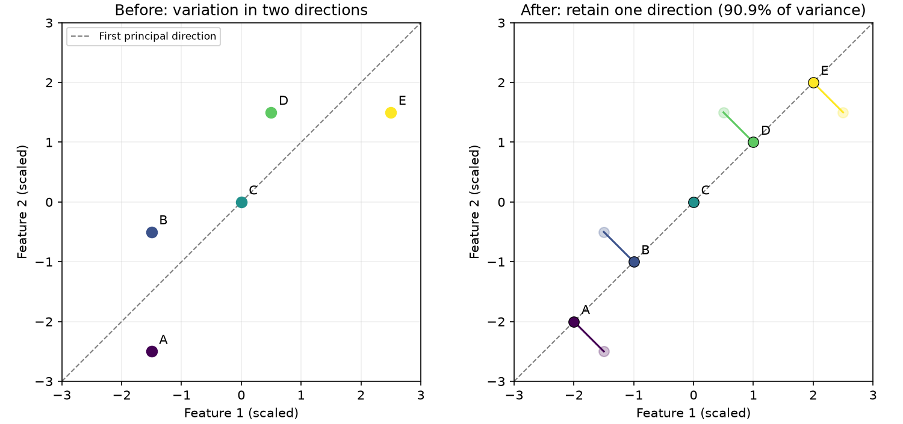

# PCA｜視覺化數學推導與學習筆記

本階段先從圖與數字理解二維降成一維，再接 NumPy。已能說明「選擇投影變異數最大的方向，將中心化資料投影成一維位置」；矩陣與特徵分解的完整獨立推導尚未驗收。

## 1. 問題：兩個 Features，如何壓成一個數字？

設備原本有溫度與振動兩個 Features。若兩欄經常一起增加，部分變化可能重複；希望以較少座標保留主要變化，方便視覺化或後續分析。

PCA（Principal Component Analysis，主成分分析）尋找資料變化最多的方向。它不使用分類標籤，也不保證保留的方向最有利於分類。變異大也可能來自雜訊或異常值。

本筆記的座標視為已處理尺度的特徵，不是原始攝氏溫度與振動單位。中心化與標準化不同：中心化只減平均；標準化還除以標準差。是否標準化會影響 PCA 的方向，必須依特徵單位與任務選擇。

## 2. 先看圖：Projection 是什麼？

第一組資料：

| 設備 | 第一欄 | 第二欄 |
|---|---:|---:|
| A | −2 | −2 |
| B | −1 | −1 |
| C | 0 | 0 |
| D | 1 | 1 |
| E | 2 | 2 |



Projection（投影）：從原點以外的資料點向目標線作垂線，垂足是它在該線上的投影位置；點已在線上時不移動。這裡的線通過中心化資料的原點。

- 綠色右上方向沿著資料延伸，投影後仍保留五個不同位置。
- 棕色右下方向與資料延伸方向垂直，五個點投影後全部重疊在原點。
- 原始資料沒有被改成方向向量；改變的是拿來測量位置的方向。
- 不是為了得到零才選垂直方向，而是投影到垂直方向後，這組資料剛好全部得到零。

雖然圖仍畫在二維平面上，投影後只需要「沿線的位置」一個數字，即是一維表示。

## 3. 方向與反方向不是不同的投影線

| 方向向量 | 朝向 | 所在直線 |
|---|---|---|
| [1, 1] | 右上 | 第一條 |
| [−1, −1] | 左下 | 同一條，箭頭掉頭 |
| [1, −1] | 右下 | 與第一條垂直 |
| [−1, 1] | 左上 | 第二條的反方向 |

兩個係數一起反號，投影位置也一起反號，但點之間的距離與變異數不變。PCA 輸出的方向正負不唯一，不能只憑反號判斷結果錯誤。

## 4. 為什麼除以 √2？單位方向的意義

[1, 1] 的長度來自畢氏定理：

$$
\sqrt{1^2+1^2}=\sqrt{2}\approx1.4142
$$

√ 表示平方根：找一個數字，使它乘自己得到根號內的值。

將每個分量都除以長度，得到長度為 1 的單位方向：

$$
u=\frac{[1,1]}{\sqrt{2}}\approx[0.7071,0.7071]
$$

這裡 u 是方向向量，兩個數字分別是沿第一、第二欄的方向分量。它們平方加總為 1。

必須固定方向長度，否則任意放大方向係數，就能任意放大投影位置及其變異數，無法公平比較方向。

與它垂直的單位方向可選：

$$
v=\frac{[1,-1]}{\sqrt{2}}\approx[0.7071,-0.7071]
$$

## 5. 投影位置怎麼算？

對已中心化的一筆 [x₁, x₂]，沿 u 的有正負位置為：

$$
z=x_1u_1+x_2u_2
$$

| 符號 | 意義與運算角色 |
|---|---|
| x₁、x₂ | 該筆中心化後的兩欄；下標區分欄位 |
| u₁、u₂ | 單位方向的兩個係數 |
| z | 沿所選方向的一維位置，不是類別或機率 |

負位置在箭頭反方向，正位置在箭頭方向。

沿右上方向：

| 設備 | 計算 | 一維位置 |
|---|---|---:|
| A | −2×0.7071 − 2×0.7071 | 約 −2.8284 |
| B | −1×0.7071 − 1×0.7071 | 約 −1.4142 |
| C | 0＋0 | 0 |
| D | 1×0.7071＋1×0.7071 | 約 1.4142 |
| E | 2×0.7071＋2×0.7071 | 約 2.8284 |

沿垂直方向時，每筆兩欄貢獻互相抵銷；例如 D：1×0.7071＋1×(−0.7071)=0。



```python
direction = np.array([1.0, 1.0]) / np.sqrt(2)
projected = centered @ direction
```

`@` 表示每筆資料的各欄與對應方向係數相乘再加總。輸入 (5, 2)，方向 (2,)，輸出 (5,)；若方向保存為 (2, 1)，輸出則是 (5, 1)。

## 6. 為什麼用 Variance 比較方向？

目的不是讓投影數字越大越好，而是讓投影後仍保留資料間的變化。

- [100,100,100]：數字大，但三筆完全相同。
- [−2,0,2]：數字較小，但三筆分開。

### 6.1 減平均：用自己的中心當參考

第一組平均 100，減平均後為 [0,0,0]。第二組平均 0，減平均後為 [−2,0,2]。這樣才能分辨「位置離原點很遠」與「資料本身很分散」。

### 6.2 平方：避免左右抵銷

直接平均 [−2,0,2] 會得到 0，無法表達分散程度。平方後 [4,0,4]，兩側都貢獻正值，較遠的點貢獻更多。

取絕對值也能衡量分散，但變異數採用平方這個定義；平方也讓後面的線性代數表示成立。

### 6.3 取平均：得到平均每筆的偏離平方

$$
\operatorname{Var}(z)=\frac1n\sum_{i=1}^{n}(z_i-\bar z)^2
$$

- Var：變異數。
- n：資料筆數。
- i：第幾筆；Σ 表示從第一筆加到第 n 筆。
- zᵢ：第 i 筆投影位置；z̄：投影位置的平均。
- 平方後的單位是位置單位的平方，變異數不是距離本身。

[−2,0,2] 的變異數為 (4+0+4)/3=8/3≈2.67。

第一組資料投影到右上後：

```text
位置：[−2.8284, −1.4142, 0, 1.4142, 2.8284]
平均：0
偏離量平方：約 [8, 2, 0, 2, 8]
變異數：(8+2+0+2+8)/5 = 4
```

垂直方向全部 0，變異數為 0。PCA 選投影變異數最大的單位方向，而不是只找「非零值的方向」。即使兩個方向都有變異，也會依大小排序。

本筆記統一除以 n，與 `np.var(..., ddof=0)` 一致。常見的樣本共變異數除以 n−1；兩種慣例對相同資料的特徵值有比例差，方向及解釋變異比例不變，但不可混用數值。

## 7. Covariance：兩欄如何一起變動？

變異數看一欄自己有多分散；共變異數看兩欄相對各自平均的共同變動。

$$
\operatorname{Cov}(x_1,x_2)=\frac1n\sum_{i=1}^{n}(x_{i1}-\bar x_1)(x_{i2}-\bar x_2)
$$

xᵢ₁ 表示第 i 筆第一欄，x̄₁ 為第一欄平均；第二欄同理。

- 兩欄都高於平均：正×正，貢獻正值。
- 兩欄都低於平均：負×負，貢獻正值。
- 一欄高、一欄低：相乘為負值。

正共變異數表示傾向同向變動；負值表示傾向反向變動。零共變異數不保證獨立，也不排除非線性關係。

第一組資料兩欄平均均為 0：

| 設備 | 第一欄偏離 | 第二欄偏離 | 相乘 |
|---|---:|---:|---:|
| A | −2 | −2 | 4 |
| B | −1 | −1 | 1 |
| C | 0 | 0 | 0 |
| D | 1 | 1 | 1 |
| E | 2 | 2 | 4 |

平均為 10/5=2。兩欄各自的變異數也為 2。

## 8. 共變異數矩陣：將結果放在同一張表

|  | 第一欄 | 第二欄 |
|---|---:|---:|
| 第一欄 | 變異數 2 | 共變異數 2 |
| 第二欄 | 共變異數 2 | 變異數 2 |

```text
[[2, 2],
 [2, 2]]
```

對角線是各欄變異數，另外兩格是共變異數。交換相乘順序不影響結果，因此矩陣對稱。這次四格相同是因為兩欄資料相同，不是一般規則。

展開寫法：

```python
means = np.mean(X, axis=0)
centered = X - means
first = centered[:, 0]
second = centered[:, 1]
var_first = np.mean(first * first)
var_second = np.mean(second * second)
covariance = np.mean(first * second)
covariance_matrix = np.array([
    [var_first, covariance],
    [covariance, var_second],
])
```

`axis=0` 每欄分別平均；`[:, 0]` 取所有列第一欄；陣列 `*` 是相同位置逐項相乘。

## 9. Eigenvector 與 Eigenvalue：先代數字驗證

對第一組矩陣，先試 [1,1]：

```text
第一列：2×1 + 2×1 = 4
第二列：2×1 + 2×1 = 4

矩陣 × [1,1] = [4,4] = 4 × [1,1]
```

再試 [1,−1]：

```text
第一列：2×1 + 2×(−1) = 0
第二列：2×1 + 2×(−1) = 0

矩陣 × [1,−1] = [0,0] = 0 × [1,−1]
```

Eigenvector（特徵向量）是矩陣相乘後，可表示為原非零向量乘上一個數字的向量；Eigenvalue（特徵值）就是該倍率。零特徵值會將向量映成零向量，不應將此情況說成仍有朝向的箭頭。

$$
Cu=\lambda u
$$

C 在這裡是共變異數矩陣，不是 SVM 的超參數；u 是方向；λ（lambda）是特徵值，表示倍率。對共變異數矩陣的單位特徵向量，λ 也等於沿該方向投影的變異數。

此處是代入已知方向確認關係，尚不是一般特徵分解求解過程的獨立推導。

## 10. 為什麼特徵值等於投影變異數？保留的推導

設中心化後兩欄為 x、y，投影方向係數為 a、b：

$$
z=ax+by
$$

中心化後投影平均也為零。將投影位置平方：

$$
(ax+by)^2=a^2x^2+2abxy+b^2y^2
$$

這來自乘法分配律：兩個交叉項 abxy 加起來成為 2abxy。逐筆取平均：

$$
\operatorname{Var}(z)=a^2\operatorname{Var}(x)+2ab\operatorname{Cov}(x,y)+b^2\operatorname{Var}(y)
$$

對第一組資料，a=b=1/√2，所以 a²=b²=1/2，2ab=1：

```text
投影變異數 = 0.5×2 + 1×2 + 0.5×2 = 4
```

矩陣寫法為：

$$
\operatorname{Var}(z)=u^TCu
$$

ᵀ 是轉置，將列與欄交換；左邊 uᵀ 使最後結果成為單一數值。若 Cu=λu，且 u 是單位向量：

$$
u^TCu=u^T(\lambda u)=\lambda(u^Tu)=\lambda\times1=\lambda
$$

uᵀu 是各分量平方加總，單位向量時為 1。這將「倍率」接到「投影變異數」。

對實對稱共變異數矩陣，任意單位方向可由正交的單位特徵向量組合；投影變異數是各特徵值依係數平方加權的結果，這些係數平方加總為 1，因此不會超過最大特徵值。選最大特徵值對應方向即可達到最大值。這段屬於後續線性代數補強，尚未完成獨立推導驗收。

## 11. 第二組資料：不再完全排成直線

| 設備 | 第一欄 | 第二欄 |
|---|---:|---:|
| A | −1.5 | −2.5 |
| B | −1.5 | −0.5 |
| C | 0 | 0 |
| D | 0.5 | 1.5 |
| E | 2.5 | 1.5 |



左圖為原始位置；右圖淡色點為原位置、實色點為投影位置，連線表示被捨棄的垂直偏離。右圖仍以二維畫出投影，是為了看清差異；實際壓縮結果每筆只保存一個數字。

### 11.1 每欄平均

```text
第一欄：(−1.5−1.5+0+0.5+2.5)/5 = 0
第二欄：(−2.5−0.5+0+1.5+1.5)/5 = 0
```

因此中心化後資料不變。

### 11.2 每欄變異數與兩欄共變異數

| 設備 | 第一欄平方 | 第二欄平方 | 兩欄相乘 |
|---|---:|---:|---:|
| A | 2.25 | 6.25 | 3.75 |
| B | 2.25 | 0.25 | 0.75 |
| C | 0 | 0 | 0 |
| D | 0.25 | 2.25 | 0.75 |
| E | 6.25 | 2.25 | 3.75 |
| 加總 | 11 | 11 | 9 |
| 除以 5 | 2.2 | 2.2 | 1.8 |

```text
共變異數矩陣：
[[2.2, 1.8],
 [1.8, 2.2]]
```

等價的 NumPy 運算：

```python
covariance_matrix = centered.T @ centered / len(X)
```

`centered.T @ centered` 得到 [[11,9],[9,11]]，除以 5 得到上述矩陣。

### 11.3 算出兩個方向的倍率

右上 [1,1]：

```text
第一列：2.2×1 + 1.8×1 = 4
第二列：1.8×1 + 2.2×1 = 4
結果 [4,4] = 4×[1,1]
```

右下 [1,−1]：

```text
第一列：2.2×1 + 1.8×(−1) = 0.4
第二列：1.8×1 + 2.2×(−1) = −0.4
結果 [0.4,−0.4] = 0.4×[1,−1]
```

單位化後方向為 [0.7071,0.7071]、[0.7071,−0.7071]，特徵值仍為 4、0.4。只保留一維時，選右上方向。

### 11.4 逐筆投影

| 設備 | 計算 | 一維位置 |
|---|---|---:|
| A | −1.5×0.7071−2.5×0.7071 | 約 −2.8284 |
| B | −1.5×0.7071−0.5×0.7071 | 約 −1.4142 |
| C | 0＋0 | 0 |
| D | 0.5×0.7071＋1.5×0.7071 | 約 1.4142 |
| E | 2.5×0.7071＋1.5×0.7071 | 約 2.8284 |

兩組資料得到相同的一維位置，因為第二組增加的偏移都在被捨棄的垂直方向。不能僅由一維位置辨識原本來自哪一組資料。

### 11.5 保留比例與近似還原

```text
總變異量 = 4 + 0.4 = 4.4
保留變異比例 = 4/4.4 ≈ 90.9%
捨棄變異比例 ≈ 9.1%
```

Explained Variance Ratio（解釋變異比例）是某個主方向的特徵值除以全部特徵值總和，不是分類或預測正確率。

第一組原本各欄變異數為 2、2，總和 4，投影後變異數 4，完整保留總變異量；不是「每一欄變異數都不變」。第二組總變異量為 4.4，只留下 4。

例如第二組 D 的一維位置為 √2，放回主方向：

```text
√2 × [1/√2,1/√2] = [1,1]
原本 [0.5,1.5] → 近似還原 [1,1]
```

若原始平均不為零，還原時還要加回平均。垂直偏離已經捨棄，因此不能完整還原原位置。

## 12. NumPy 對照：中心化 → 找方向 → 排序 → 投影

以下為本輪第二組資料的教學區塊，不代表正式 Train／Validation／Test 主線已完成：

```python
import numpy as np

X = np.array([
    [-1.5, -2.5],
    [-1.5, -0.5],
    [ 0.0,  0.0],
    [ 0.5,  1.5],
    [ 2.5,  1.5],
])
means = np.mean(X, axis=0)
centered = X - means
covariance_matrix = centered.T @ centered / len(X)

eigenvalues, eigenvectors = np.linalg.eigh(covariance_matrix)
order = np.argsort(eigenvalues)[::-1]
eigenvalues = eigenvalues[order]
eigenvectors = eigenvectors[:, order]

components = eigenvectors[:, :1]
projected = centered @ components
explained_variance_ratio = eigenvalues / np.sum(eigenvalues)

print(covariance_matrix)
print(eigenvalues)
print(components)
print(projected)
print(explained_variance_ratio[0])
```

| 語法 | 用途 |
|---|---|
| `np.linalg.eigh` | 對實對稱矩陣找特徵值與正交單位特徵向量 |
| `eigenvectors[:, i]` | 第 i 欄是對應第 i 個特徵值的方向，不能橫著讀 |
| `np.argsort(...)[::-1]` | 找由大到小的位置編號 |
| `eigenvectors[:, order]` | 方向欄位跟著特徵值同步排序 |
| `[:, :1]` | 取第一欄且保留二維形狀 |
| `centered @ components` | 每筆沿保留方向的投影位置 |

`eigh` 原先回傳由小到大的特徵值 [0.4,4]，排序後為 [4,0.4]。預期投影形狀 (5,1)，保留比例約 0.9091。特徵向量整組反號是合法結果。

全部資料皆相同時，總變異量為零，比例會遇到除以零；正式函式需要另行處理。此教學區塊尚未加入該防護。

## 13. 平均位置與直線截距：非零中心的還原例子

方向向量只決定方向，Train 平均決定主軸的位置。平均不在原點時，主軸也可能有非零截距；PCA 將這個位置保存在 mean，不需要另外存直線的 b。

```text
Train 平均：[10,5]
原始資料：[10.5,6.5]
減平均後：[0.5,1.5]
```

沿右上、右下單位方向的位置分別為 √2、−1/√2。還原兩方向貢獻：

```text
右上：√2×[1/√2,1/√2] = [1,1]
右下：−1/√2×[1/√2,−1/√2] = [−0.5,0.5]
相加：[0.5,1.5]
加回平均：[0.5,1.5]+[10,5] = [10.5,6.5]
```

通過 [10,5] 的右上主軸滿足 x₂−5=x₁−10，即 x₂=x₁−5，確實有截距 −5。先減平均、還原後再加回，已保存這個位置資訊。

只保留右上方向時，只能得到 [1,1]+[10,5]=[11,6]；平均能補回中心，不能補回捨棄方向的偏移。

## 14. 累積變異與選擇維度

後面的單一主成分可具有較小變異，但保留更多方向的變異總和不會減少。若依序是 80%、13%、4%、3%，累積為 80%、93%、97%、100%；以 95% 門檻選擇時需保留三維。

只有當第一個方向已達需求時，才選一維。保留 95% 變異不是保證預測正確率為 95%，門檻是任務選擇。完整保留原維度只是換座標，理論上可以完整還原；程式的極小誤差來自浮點運算。

## 15. 實作進度

本筆記保存完整教學推導；正式結果與最新驗收狀態以 README.md 為準。fit_pca、transform_pca、inverse_transform_pca 已完成，原有數字範例與檢查保留在 pca_learning.py。完整獨立數學推導尚未驗收。
