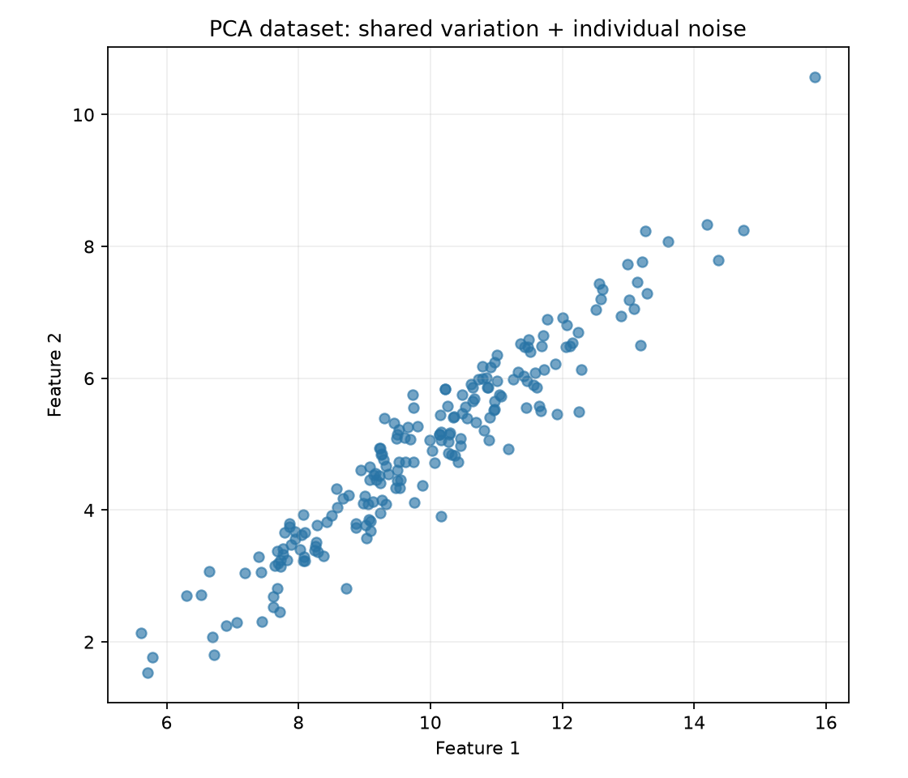
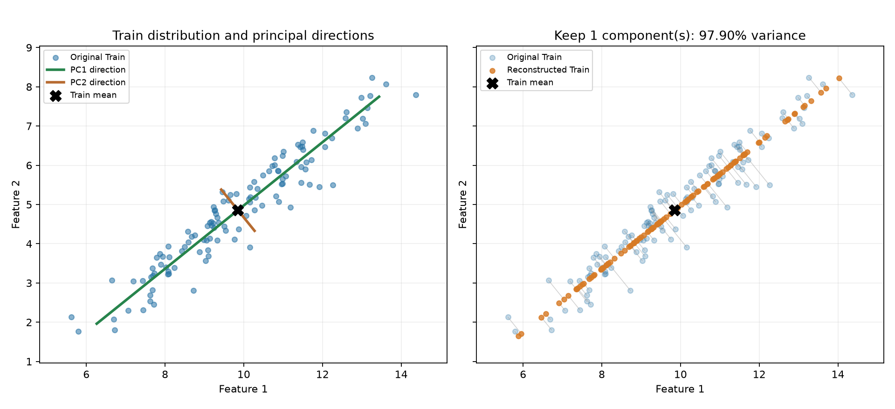

# L08-B｜PCA From Scratch

以二維合成資料理解 Projection、Variance、Covariance 與主成分，使用 NumPy 完成訓練、降維及近似還原。主線實驗已完成，A1 核心理論驗收 PASS；完整特徵分解的獨立推導仍待複習。

## 主線流程

```text
建立資料 → 固定 Train／Validation／Test
    → Train 學平均與主方向
    → 比較保留一維／兩維
    → 選達到 95% Train 變異保留門檻的最少維度
    → 選定模型評估 Test 還原誤差
    → 主方向與近似還原圖
```

PCA 不使用分類標籤，也不執行梯度下降。第一主成分找投影變異數最大的單位方向，後續主方向與先前方向正交，依變異數排序。

## 檔案分工

| 檔案 | 用途 |
|---|---|
| `pca.py` | 核心函式與正式主線 |
| `pca_learning.py` | 原有逐步計算、兩組五筆資料與函式檢查 |
| `PCA_DERIVATION_NOTES.md` | 完整推導、符號翻譯、逐筆數字與三張教學圖 |
| `pca_dataset.png` | 正式資料分布 |
| `pca_projection_reconstruction.png` | Train 主方向、投影與近似還原 |
| `images/` | 小型例子的教學圖 |

修改前版本保留為 `.bak`，不參與執行。

## 函式與資料形狀

| 函式 | 輸入 → 輸出 |
|---|---|
| `fit_pca(X, n_components)` | Train、保留方向數 → 平均、方向、變異數與保留比例 |
| `transform_pca(X_new, model)` | 資料、已學模型 → 低維位置 |
| `inverse_transform_pca(projected, model)` | 低維位置、模型 → 原空間的近似還原 |
| `plot_pca_reconstruction(X_train, model)` | Train 與選定模型 → 圖片路徑 |

若原資料為 (n,d)、保留 k 個主成分：mean 為 (d,)、components 為 (d,k)、projected 為 (n,k)，還原資料為 (n,d)。components 每一欄是一個單位方向。

```python
# 學規則：只使用 Train
model = fit_pca(X_train, n_components=1)

# 套用相同中心與方向
projected = (X_new - model["mean"]) @ model["components"]

# 放回原空間，加回中心
reconstructed = projected @ model["components"].T + model["mean"]
```

平均決定主軸通過哪裡；方向決定主軸怎麼傾斜。只保留部分方向會丟失細節，保留所有正交方向則只是換座標，理論上可完整還原。反轉方向的正負只會反轉位置符號，不改變還原結果或變異量。

## 實驗設定

- 200 筆、兩欄可比較尺度的抽象感測特徵，沒有分類標籤。
- `data_seed=42`、`split_seed=42`，固定切分 120／40／40。
- `shared` 為平均 0、標準差 2 的共同變化。
- 每筆兩欄各有平均 0、標準差 0.35 的獨立擾動。
- 第一欄 `10 + shared + noise_1`；第二欄 `5 + 0.8*shared + noise_2`。
- 只中心化，不額外標準化。不同尺度的真實資料需先依任務決定是否標準化；尺度也只能從 Train 學。
- 共變異數統一除以 n，與 `np.var` 預設一致。部分教材／工具除以 n−1，數值需留意慣例。



## 實驗結果與選擇規則

| 保留維度 | Train 變異保留比例 | Train 還原 MSE | Validation 還原 MSE |
|---:|---:|---:|---:|
| 1 | 97.9001% | 0.05694363 | 0.04992816 |
| 2 | 100% | 約 0 | 約 0 |

Train 平均約 [9.85043706,4.85504047]；第一主方向約 [−0.77845456,−0.62770096]，其特徵值約 5.30952003。方向反號仍代表同一條軸。

示範需求：至少保留 95% Train 變異量，選達標的最少候選維度，因此選一維。95% 是本次需求，並非 PCA 固定規定。Validation 用於觀察還原誤差，並未用最低 Validation MSE 選維度；否則保留全部方向自然占優勢，卻沒有降維。

選定 Train 模型直接轉換 Test，形狀 (40,2) → (40,1)，**Test 還原 MSE=0.04978264**。Test 不重新學平均或方向，也不回頭用 Test 結果調整門檻。

MSE 定義：

```python
np.mean((X - reconstructed) ** 2)
```

對所有樣本及所有欄位平均，是座標還原誤差，不是分類錯誤率。在本次 Train 上，MSE×2 等於捨棄的特徵值總和；因為每筆平均平方距離與逐元素 MSE 的分母不同。此關係不直接套用到新的 Validation／Test。

## 圖像觀察



- 左圖：藍點是 Train，黑 X 是平均，綠線 PC1 是主要延伸方向，棕線 PC2 與它垂直。
- 主軸通過 Train 平均；線段長度以各方向正負兩個標準差展示，不是分類邊界。
- 右圖：淡藍點是原始位置，橘點是近似還原位置，灰線是被捨棄的偏離。
- 橘點都位於第一主軸，圖上畫回二維是為了比較，低維資料本身每筆只保存一個位置。
- 97.90% 是 Train 的變異保留比例，不是準確率，也不保證所有新資料保留相同比例。

## 驗證與執行

從 MachineLearning 根目錄執行：

```bash
.venv/bin/python 11_pca_from_scratch/pca.py
.venv/bin/python 11_pca_from_scratch/pca_learning.py
```

需要 NumPy、Matplotlib。圖片存入本資料夾，不自動彈出視窗。匯入 pca.py 不執行主線。

已通過：資料切分無重疊且無遺漏、訓練平均來自 Train、主方向正交單位長度、投影與還原形狀、有限誤差、Train 捨棄變異與 MSE 的關係、保留全部維度時 Validation 近似完整還原，以及原有五筆數字例子的檢查。

## 學習摘要與限制

已能描述選最大變異方向、單位化方向、中心化後投影，以及加回平均近似還原的流程。主成分數量採達標的最少維度；後續單一方向的變異量可較低，但同一份資料保留更多主方向時，總保留變異量不會減少。

| 能力 | 目前狀態 |
|---|---|
| 投影、平均位置、變異保留與資訊損失 | 已能對照圖說明 |
| NumPy 主線、Train／Validation／Test 流程 | 已完成實作 |
| 核心理論問答 | A1 最後一題確認 PASS；原始回答與修正見 THEORY_QA.md |
| 共變異數、特徵值關係的獨立回憶與推導 | 待複習 |
| 陌生資料的獨立應用 | 尚未驗收 |

PCA 保留變化，不保證保留最有利於分類／回歸的資訊。大變異可能包含雜訊或異常值；沒有在本輪驗證降維後的下游預測表現。二維合成資料與固定切分的成功不等同所有資料都適合降到一維。

完整圖解與數學不刪減，見 [PCA_DERIVATION_NOTES.md](PCA_DERIVATION_NOTES.md)。

理論問答與 A1 驗收結果見 [THEORY_QA.md](THEORY_QA.md)。下一步進行 Phase 01 整合驗收。
